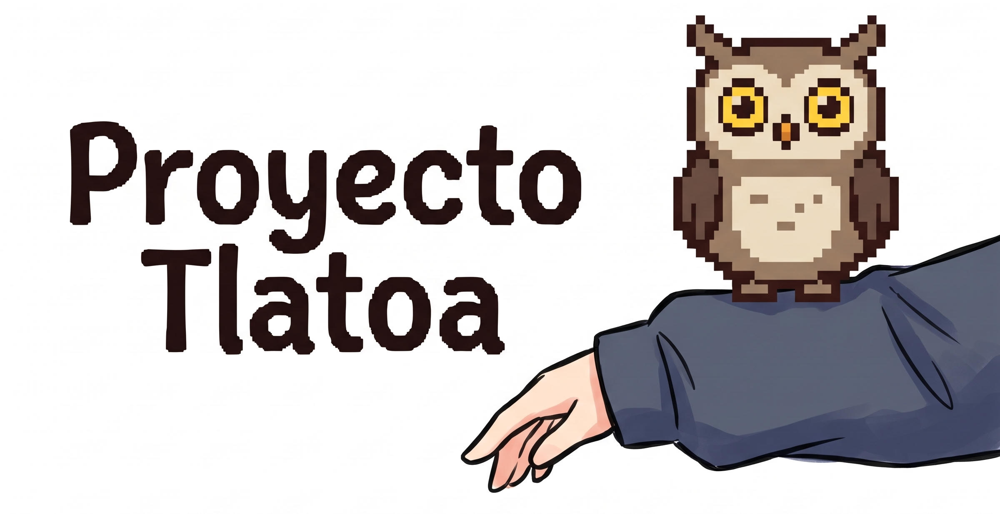
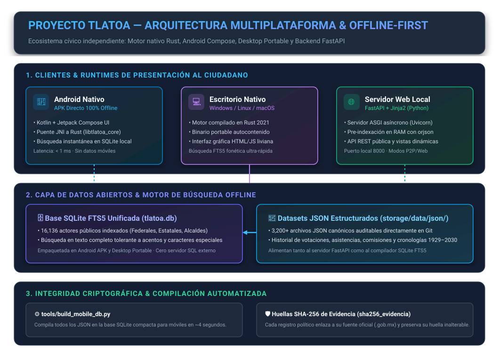
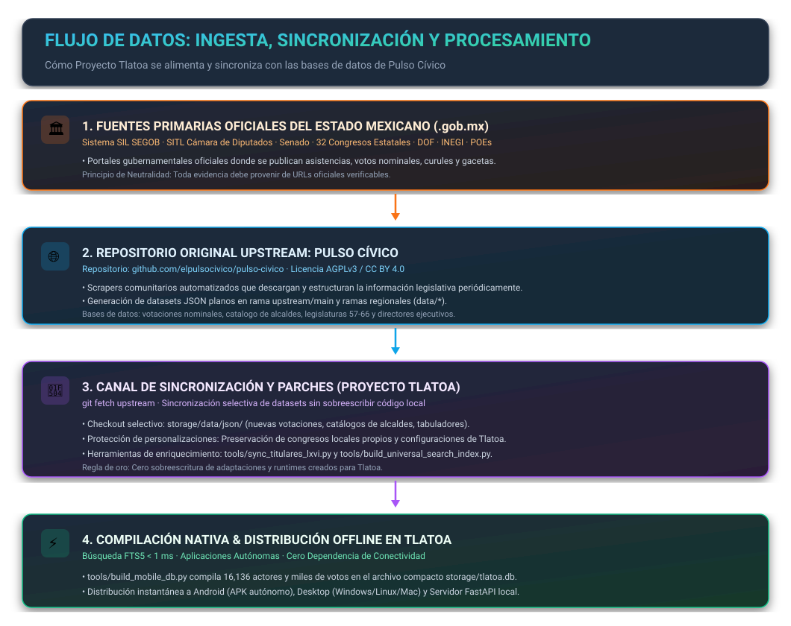

# Proyecto Tlatoa

<p align="center">
  
</p>

> **Plataforma ciudadana independiente, abierta y 100% desconectada (offline) para la fiscalización del poder público en México.**

<p align="center">
  <a href="https://www.rust-lang.org/"></a>
  <a href="https://kotlinlang.org/"></a>
  <a href="https://www.sqlite.org/"></a>
  <a href="https://fastapi.tiangolo.com/"></a>
  <a href="LICENSE"></a>
  <a href="docs/legal/DATA_LICENSE.md"></a>
</p>

---

## 📖 ¿Qué es Proyecto Tlatoa?

En la lengua náhuatl, *Tlatoa* significa **"el que habla"** o **"hacer escuchar la voz"** (de donde proviene el término histórico *Tlatoani*).

**Proyecto Tlatoa** es una herramienta de consulta ciudadana y soberanía de datos que permite conocer en **menos de 1 milisegundo** el historial real de los representantes populares en México:
* **Trayectoria y Deserciones:** ¿Cuántas veces ha cambiado de bancada un legislador ("chapulineo")?
* **Votaciones y Asistencias:** ¿Cómo votó en las reformas cruciales y cuál es su registro de asistencias?
* **Escolaridad y Suplencias:** ¿Quién es su suplente oficial y cuál es su grado académico comprobable?
* **100% Desconectado (Offline):** La base de datos completa de México viene integrada dentro de la aplicación (`storage/tlatoa.db`), operativa sin conexión celular ni consumo de datos móviles.

---

## 🏛️ Arquitectura del Sistema y Funcionamiento Actual

Proyecto Tlatoa combina runtimes multiplataforma para el usuario final con un núcleo de almacenamiento estructurado y un canal de integridad criptográfica:



### Runtimes Disponibles:
1. **📱 Android Nativo (.APK directo):** Escrito en **Kotlin + Jetpack Compose** con motor ultrarrápido en **Rust** (`crates/tlatoa-core`) vía JNI. Búsqueda instantánea en base SQLite FTS5 local sin depender de Google Play Store.
2. **💻 Escritorio Nativo (Windows, Linux, macOS):** Aplicación portable autocontenida compilada en **Rust 2021** (`crates/tlatoa-desktop`). No requiere instalar Python ni dependencias externas.
3. **🌐 Servidor Web Local (Python + FastAPI):** Servidor asíncrono ASGI con renderizado Jinja2 y pre-indexación en memoria RAM mediante `orjson` (< 15 ms por consulta).

---

## 🔄 Ingesta y Sincronización con Pulso Cívico

Proyecto Tlatoa es una bifurcación independiente (Hard Fork) que se alimenta continuamente de fuentes gubernamentales primarias y mantiene un pipeline de sincronización selectiva con las bases de datos abiertas del proyecto original **[Pulso Cívico](https://github.com/elpulsocivico/pulso-civico)**:



1. **Fuentes Oficiales Primarias:** Extracción desde portales `.gob.mx` (SIL-SEGOB, SITL Diputados, Senado, 32 Congresos Estatales, Periódicos Oficiales Estatales, DOF e INEGI).
2. **Upstream Pulso Cívico:** Extracción masiva comunitaria en el repositorio base `elpulsocivico/pulso-civico`.
3. **Pipeline de Sincronización Tlatoa:** `git fetch upstream` incorpora nuevos datasets (`storage/data/json/`) y parches de indexación (`tools/`) preservando intactas las personalizaciones locales y runtimes propios de Tlatoa.
4. **Compilación Multiplataforma:** `tools/build_mobile_db.py` transforma los más de 3,200 datasets JSON en la base de datos binaria compacta `storage/tlatoa.db` con búsqueda FTS5 tolerante a acentos.

## [!IMPORTANTE]
### 🕷️ Suite de Scrapers (Rama Huérfana `scrapers`) y Política de Contribuciones
Para preservar la ligereza del repositorio de aplicaciones y runtimes offline, la suite completa de extractores (PHP, Python y Lua) se mantiene aislada en la rama huérfana **`scrapers`**:
> ```bash
> # Inspeccionar o utilizar los extractores
> git checkout scrapers
> ```
o tambien solo clonar la rama y hacer PR manualmente en el [Repositorio Base](https://github.com/elpulsocivico/pulso-civico)

> ```bash
> git clone https://github.com/Proyecto-Tlatoa/proyecto-tlatoa -b scrapers
> ```

Consulta el `README.md` de dicha rama para conocer los parámetros de ejecución, cumplimiento de `robots.txt` y directivas éticas de rate-limiting (1,250 ms).

**🚫 Aviso de Pull Requests en este Hard Fork:** 

En este repositorio **no se aceptan Pull Requests**. Si desarrollas o mejoras un scraper, o deseas incorporar nuevos datasets, envía tu contribución mediante Pull Request directamente al repositorio base upstream: **[`pulso-civico/pulso-civico/main`](https://github.com/elpulsocivico/pulso-civico)** siguiendo los contratos canónicos de datos.

---

## 📚 Documentación Integral del Proyecto

> 🧭 **Guía Completa para Desarrolladores:** Consulta **[`index.md`](index.md)** para conocer la constitución del proyecto, el mapa exhaustivo de cada carpeta y archivo, y las instrucciones de desarrollo.

Toda la documentación está clasificada en cuatro secciones temáticas:

### 1. 🏛️ Arquitectura, Filosofía y Resiliencia
* [**index.md**](index.md) — **Guía Maestra y Mapa Arquitectónico del Repositorio**.
* [**Arquitectura del Sistema**](docs/ARQUITECTURA.md) — Arquitectura técnica integral, modelo de grafo ciudadano y desacoplamiento persona vs. mandato.
* [**Manifiesto Ético**](docs/MANIFIESTO.md) — Manifiesto ciudadano, principios inviolables de neutralidad fáctica y código abierto.
* [**Protocolo de Resiliencia**](docs/PLAN_RESILIENCIA_Y_PRESERVACION.md) — Protocolo formal de resiliencia, integridad criptográfica (SHA-256 / Merkle) y preservación digital.
* [**Historial de Migración**](docs/historial/HISTORIAL_MIGRACION.md) — Registro de auditoría técnica y resolución de anomalías estructurales históricas.

### 2. 📊 Modelos, Esquemas y Fuentes Oficiales
* [**Esquemas de Datos (Data Schema)**](docs/DATA_SCHEMA.md) — Contratos canónicos de datos y esquemas JSON (`snake_case`, UTF-8).
* [**Diccionario de Datos**](docs/DICCIONARIO_DE_DATOS.md) — Diccionario completo de entidades, tablas, campos y relaciones.
* [**Fuentes Oficiales**](docs/FUENTES.md) — Catálogo de fuentes primarias oficiales del Estado mexicano (.gob.mx).
* [**Cobertura Estatal**](docs/ESTADOS_COBERTURA.md) — Estado de cobertura legislativa y datasets de los 32 estados.
* [**Poder Ejecutivo Estatal**](docs/PODER_EJECUTIVO_ESTADOS.md) — Modelo de datos y cobertura de mandatarios estatales y regentes (1929–2030).

### 3. 🛠️ Desarrollo, Scrapers y Contribución
* [**Suite de Scrapers (Rama Huérfana `scrapers`)**](https://github.com/Proyecto-Tlatoa/proyecto-tlatoa/tree/scrapers) — Suite completa de extractores oficiales (PHP, Python, Lua) en entorno aislado.
* [**Cómo Crear un Scraper**](docs/COMO_CREAR_UN_SCRAPER.md) — Guía paso a paso para programar extractores en Lua o Python.
* [**Playbook de Congresos Locales**](docs/PLAYBOOK_LOCALES.md) — Playbook de extracción para congresos locales y alcaldías asistida por IA.
* [**Pipeline de Staging**](docs/PIPELINE_STAGING.md) — Buzón seguro para enviar evidencia ciudadana sin programar.
* [**Reglas para Asistentes de IA (AGENTS.md)**](AGENTS.md) — Reglas obligatorias para asistentes de Inteligencia Artificial (Claude, Gemini, ChatGPT, Codex, Cursor).
* [**Guía de Contribución**](.github/CONTRIBUTING.md) — Guía de colaboración comunitaria y estándares de Pull Requests.

### 4. 📱 Soporte y Operación
* [**Solución de Problemas**](docs/SOLUCION_DE_PROBLEMAS.md) — Guía de solución de problemas para Android, Windows, Linux y Web.
* [**Manual de Datos y Evidencia**](docs/MANUAL_DE_DATOS_Y_EVIDENCIA.md) — Manual de estándares de evidencia y pruebas criptográficas.

---

## 📱 Cómo Ejecutar la Aplicación

### Android (.APK directo, 100% Offline)
* Descarga `tlatoa-vX.X.X.apk` desde **[Releases](https://github.com/Proyecto-Tlatoa/proyecto-tlatoa/releases)**.
* No requiere Google Play Store ni conexión permanente. Búsquedas en < 1 ms.

### Escritorio Nativo (Windows, Linux, macOS)
* Descarga el ejecutable desde **[Releases](https://github.com/Proyecto-Tlatoa/proyecto-tlatoa/releases)**:
  * **Windows:** `tlatoa-desktop-windows-x86_64.exe`
  * **Linux:** `tlatoa-desktop-linux-x86_64` (dar permisos con `chmod +x`)
  * **macOS:** `tlatoa-desktop-macos-x86_64`

### Servidor Web Local (Python + FastAPI)
```bash
# 1. Configurar entorno
cp .env.example .env

# 2. Instalar dependencias e iniciar
pip install -r requirements.txt
uvicorn app.main:app --reload --port 8000
```
Consulta en tu navegador: `http://localhost:8000`

---

## ⚖️ Licencias y Aviso Legal

* **Código de la plataforma:** [GNU Affero General Public License v3.0 (AGPL-3.0)](LICENSE).
* **Datasets de datos abiertos:** [Creative Commons Atribución 4.0 Internacional (CC BY 4.0)](docs/legal/DATA_LICENSE.md).
* **Aviso Legal e Identidad:** [docs/legal/NOTICE.md](docs/legal/NOTICE.md).
* **Guía de Contribución y Código de Conducta:** [.github/CONTRIBUTING.md](.github/CONTRIBUTING.md) · [.github/CODE_OF_CONDUCT.md](.github/CODE_OF_CONDUCT.md).


<sub>Proyecto Tlatoa es una bifurcación independiente iniciada en octubre de 2026. Código base derivado originalmente de Pulso Cívico (Copyright (c) 2024-2026 Autores Originales), distribuido bajo licencia GNU AGPLv3. Código fuente disponible en <a href="https://github.com/Proyecto-Tlatoa/proyecto-tlatoa">https://github.com/Proyecto-Tlatoa/proyecto-tlatoa</a>.</sub>

---

## 🗺️ Navegación Rápida

* [Arquitectura del Sistema](docs/ARQUITECTURA.md) · [Manifiesto Ético](docs/MANIFIESTO.md) · [Protocolo de Resiliencia](docs/PLAN_RESILIENCIA_Y_PRESERVACION.md)
* [Esquemas de Datos](docs/DATA_SCHEMA.md) · [Diccionario de Datos](docs/DICCIONARIO_DE_DATOS.md) · [Fuentes Oficiales](docs/FUENTES.md)
* [Cobertura Estatal](docs/ESTADOS_COBERTURA.md) · [Crear Scraper](docs/COMO_CREAR_UN_SCRAPER.md) · [Solución de Problemas](docs/SOLUCION_DE_PROBLEMAS.md)
