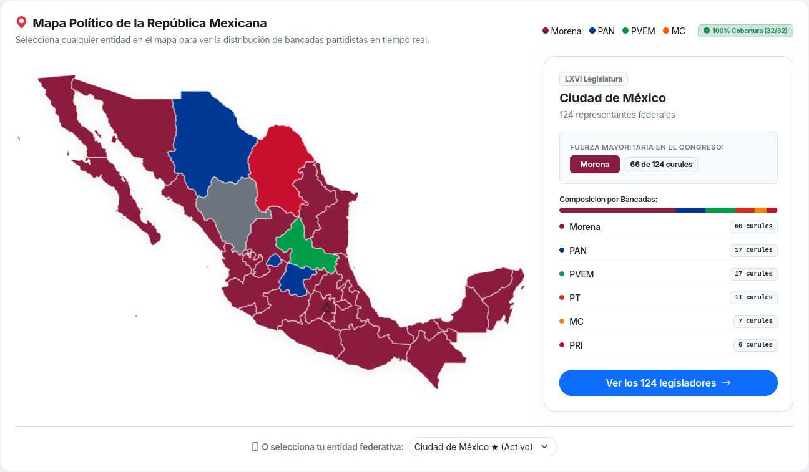

# 🇲🇽 Pulso Cívico — Guía y Documentación del Proyecto

<p align="center">
  <a href="https://www.python.org/"></a>
  <a href="https://fastapi.tiangolo.com/"></a>
  <a href="https://jinja.palletsprojects.com/"></a>
  <a href="storage/data/json/"></a>
  <a href="https://getbootstrap.com/"></a>
  <a href="https://www.php.net/"></a>
  <a href="LICENSE"></a>
  <a href="DATA_LICENSE.md"></a>
  <a href="CONTRIBUTING.md"></a>
</p>


<p align="center">
  
</p>

<p align="center">
  
</p>

> **Plataforma ciudadana, neutral y de código abierto para la transparencia política en México.**

Cruzamos **datos oficiales del gobierno** con **noticias** para mostrar el historial real de cada representante popular: qué iniciativas presentan, cómo votan en el pleno, su trayectoria partidista y el fenómeno del "chapulineo" (cambio de partido). 

**Objetivo único:** Facilitar un **voto informado y consciente**.

> [!TIP]
> **¿Eres periodista, investigador o ciudadano y quieres aportar datos sin saber programar?**  
> No necesitas saber Git ni programar para colaborar. Consulta la guía rápida y canales de envío estructurado en **[docs/PIPELINE_STAGING.md](docs/PIPELINE_STAGING.md)** y nuestro **[docs/MANIFIESTO.md](docs/MANIFIESTO.md)**.

---

## 📌 ¿Qué es lo relevante de este proyecto?

1. **Impacto Cívico Directo:**
   - En México, la información de los políticos suele estar dispersa en gacetas en PDF o portales legislativos confusos.
   - Pulso Cívico centraliza el historial legislativo, ejecutivo y municipal para que cualquier ciudadano audite a sus representantes en segundos.
2. **Neutralidad Absoluta y Verificabilidad:**
   - **Regla de oro:** Todo dato mostrado debe tener un enlace directo a una fuente oficial (`.gob.mx`) o nota periodística verificada con hash criptográfico SHA-256.
   - Cero opiniones, cero adjetivos, cero propaganda partidista.
3. **Arquitectura Híbrida de Alto Rendimiento y Low-Cost (FastAPI + JSON):**
   - **Stack primario moderno:** Desarrollado en **Python 3.10+ con FastAPI, Uvicorn, Jinja2 y orjson** para máxima velocidad de respuesta (< 15ms), concurrencia asíncrona y pre-indexación en memoria de los más de 3,200 datasets cívicos.
   - **Cero bases de datos pesadas obligatorias** (sin necesidad de configurar MySQL/PostgreSQL para correrlo localmente): los datos viven en archivos JSON estáticos en [`storage/data/json/`](storage/data/json/) versionados directamente con Git.
   - **Frontend ágil:** Bootstrap 5.3 vía CDN y JavaScript Vanilla nativo (sin frameworks SPA ni compiladores pesados).
   - **Capa CLI y Contingencia:** Mantiene herramientas CLI e ingesta histórica en PHP 8.1+ ([`tools/gateway.php`](tools/gateway.php), [`tools/run.ps1`](tools/run.ps1)) para máxima compatibilidad y auditoría.
   - Cualquier persona puede correrlo en su computadora en menos de 2 minutos.
4. **Grafo Cívico Interconectado (Todo es un hipervínculo):**
   - Modela a los actores políticos como una red navegable a través del tiempo.
   - **Persona Invariante vs. Mandatos Temporales:** La identidad del político trasciende legislaturas. Desacoplar a la persona de sus cargos permite auditar suplencias, mandatos históricos y cambios de partido a lo largo de los años ("detector de chapulines").
   - **Hipervínculos Bidireccionales:** Políticos, mandatos, partidos, comisiones, entidades federativas, municipios y votaciones están interconectados.

---

## 🧭 ¿Qué hay hoy y qué es lo que tenemos?


<p align="center">
  
</p>

### ✅ Cobertura Consolidada en el Repositorio:
- **Poder Legislativo Federal (Diputados y Senadores):** 326 JSONs / 10,983 registros correspondientes a las Legislaturas 57 a 66 (1997–2027). Incluye comisiones, asistencias parlamentarias, suplentes y trayectorias.
- **Congresos Locales (Cobertura Total en las 32 Entidades):** 320 JSONs / 10,728 registros cubriendo la totalidad de las 32 legislaturas estatales de México (Aguascalientes, Baja California, Baja California Sur, Campeche, Chiapas, Chihuahua, Ciudad de México, Coahuila, Colima, Durango, Estado de México, Guanajuato, Guerrero, Hidalgo, Jalisco, Michoacán, Morelos, Nayarit, Nuevo León, Oaxaca, Puebla, Querétaro, Quintana Roo, San Luis Potosí, Sinaloa, Sonora, Tabasco, Tamaulipas, Tlaxcala, Veracruz, Yucatán y Zacatecas).
- **Poder Ejecutivo Estatal (Gobernadores Históricos 1929–2030):** Cronologías oficiales de las **32 entidades federativas** (más de 300 mandatarios documentados, incluyendo Jefatura de Gobierno y Regentes del DDF en CDMX) en [`storage/data/json/ejecutivo/`](storage/data/json/ejecutivo/).
- **Directorio Nacional de Alcaldes Vigentes:** 2,474 registros con el 100% de presidentas y presidentes municipales de México en funciones.
- **Historial Municipal de 54 Años (1970–2024):** 2,474 JSONs / 35,700 mandatos históricos que documentan alternancia y márgenes de victoria comicio por comicio.
- **Gobiernos Municipales (Cabildos Canónicos):** Más de 2,400 JSONs en [`storage/data/json/municipios/`](storage/data/json/municipios/) que registran ediles canónicos bajo el artículo 115 constitucional y municipios por sistemas normativos internos (usos y costumbres en Oaxaca).
- **Votaciones Parlamentarias:** Registros nominales históricos (Legislaturas 63 y 64) y recientes (Legislatura 66).
- **Total de la Plataforma:** Más de **3,200 datasets JSON / 33,000+ registros** en almacenamiento estático versionado.
- **Interfaz Web Integrada:** Buscador global (`Ctrl+K`), mapa interactivo nacional, directorio de políticos, conmutador visual de legislaturas, visualizador municipal por clave INEGI (`/municipios/{cvegeo}`), explorador de alcaldes y estudios estadísticos.

### 🚧 Próximos pasos y líneas de colaboración:
1. **Módulo de Noticias y Hechos:**
   - Vincular notas periodísticas de medios acreditados con hash criptográfico SHA-256 a votaciones polémicas o cambios de bancada ("chapulineo").
2. **Profundización del Senado de la República:**
   - Enriquecer los perfiles, votaciones y comisiones de los 128 Senadores de la LXVI Legislatura.
3. **Ampliación de Cabildos Municipales:**
   - Ampliar la cobertura de síndicos y regidores en municipios donde los OPLEs publiquen sábanas de integración completa.
4. **Optimización de UI y Visualización Cívica:**
   - Mejorar componentes móviles (*mobile-first*), líneas de tiempo interactivas de mandatos políticos y herramientas de exportación de datos abiertos en CSV.
5. **Calidad de Código y Modularización:**
   - Mantener archivos < 400 líneas de código y continuar la homologación de servicios extractores.

---

## 🎯 ¿En qué puedes ayudar según tu perfil?

| Tu Perfil | Tareas Recomendadas | Guías de Referencia |
|---|---|---|
| **Programador Python (FastAPI)** | Optimizar routers, endpoints de búsqueda, analítica en Jinja2 o scrapers asíncronos. | [app/](app/), [requirements.txt](requirements.txt) y [docs/ARQUITECTURA.md](docs/ARQUITECTURA.md) |
| **Programador PHP** | Mantener herramientas de consola, gateway, scrapers históricos o scripts de auditoría. | [tools/](tools/) y [docs/COMO_CREAR_UN_SCRAPER.md](docs/COMO_CREAR_UN_SCRAPER.md) |
| **Frontend / Diseñador** | Mejorar la experiencia móvil (*mobile-first*), diseño de tarjetas de legisladores, accesibilidad y visualizaciones. | [app/templates/](app/templates/), [views/](views/) y [docs/backlog/ISSUE_02_FRONTEND_CONMUTADOR_LEGISLATURAS.md](docs/backlog/ISSUE_02_FRONTEND_CONMUTADOR_LEGISLATURAS.md) |
| **Investigador / Periodista** | Verificar datos contra gacetas oficiales, documentar fuentes o enviar datos estructurados. | [docs/FUENTES.md](docs/FUENTES.md), [docs/ESTADOS_COBERTURA.md](docs/ESTADOS_COBERTURA.md) y [docs/PIPELINE_STAGING.md](docs/PIPELINE_STAGING.md) |
| **Principiante / Estudiante** | Resolver tareas `good first issue`, documentar, reportar inconsistencias o agregar datos asistido por IA. | [AGENTS.md](AGENTS.md) y [docs/DICCIONARIO_DE_DATOS.md](docs/DICCIONARIO_DE_DATOS.md) |

---

## ⚡ Instalación y Puesta en Marcha Local

### 1. Opción Principal: Python (FastAPI + Jinja2) — *Entorno Activo Recomendado*
Es el motor activo de la plataforma por su velocidad, concurrencia asíncrona y pre-indexación en memoria de los datasets.

#### Requisitos:
- **Python 3.10 o superior**.
- **Git** (y opcionalmente **PHP 8.1+** para herramientas CLI de auditoría).

<details open>
<summary><strong>🛠️ ¿Cómo compilar / ejecutar según tu OS? (Desplegar menú)</strong></summary>
<br>

<details>
<summary><strong>🐧 Linux (Ubuntu / Debian / Fedora / Arch)</strong></summary>

```bash
# 1. Copiar archivo de entorno
cp .env.example .env

# 2. Crear entorno virtual e instalar dependencias
python3 -m venv .venv
source .venv/bin/activate
pip install -r requirements.txt
# (Opcional con uv: uv venv && uv pip install -r requirements.txt)

# 3. Iniciar el servidor FastAPI con recarga en vivo
uvicorn app.main:app --reload --port 8000

# 4. Chequeo de salud del proyecto (CLI auxiliar)
php tools/gateway.php health
```

<details>
<summary><strong>🤖 Agentes (Prompt adaptado para Linux)</strong></summary>

> Copia y pega este prompt al inicio de tu sesión con tu asistente de IA (Cursor, Claude, ChatGPT, Gemini, Copilot):

```text
Estás trabajando en Pulso Cívico sobre Linux (entorno POSIX).
REGLAS OBLIGATORIAS DE RUTAS Y ENTORNOS:
1. El servidor activo corre en Python / FastAPI en `app/main.py` sirviendo vistas Jinja2 desde `app/templates/`.
2. Todo cambio visual, de endpoints o lógica de negocio DEBE implementarse en `app/routers/`, `app/services/` y `app/templates/` (NUNCA en las carpetas legacy `src/` o `views/` a menos que sea un scraper/herramienta CLI).
3. Los datasets JSON viven en `storage/data/json/`.
4. Para verificar estado, salud o linting en terminal usa:
   - `php tools/gateway.php health`
   - `php tools/gateway.php git:status`
   - `php tools/gateway.php lint "src/Services/MiArchivo.php"`
5. Mantén neutralidad estricta, archivos < 400 líneas y enlaza siempre `fuente_url` oficial (.gob.mx). Lee `AGENTS.md` antes de proponer cambios.
```
</details>
</details>

<details>
<summary><strong>🪟 Windows (PowerShell / Terminal)</strong></summary>

```powershell
# 1. Copiar archivo de entorno
Copy-Item .env.example .env

# 2. Crear entorno virtual e instalar dependencias
python -m venv .venv
.\.venv\Scripts\Activate.ps1
pip install -r requirements.txt
# (Opcional con uv: uv venv && uv pip install -r requirements.txt)

# 3. Iniciar el servidor FastAPI con recarga en vivo
uvicorn app.main:app --reload --port 8000

# 4. Chequeo de salud con el runner centralizado de Windows
powershell -ExecutionPolicy Bypass -File .\tools\run.ps1 health
```

<details>
<summary><strong>🤖 Agentes (Prompt adaptado para Windows)</strong></summary>

> Copia y pega este prompt al inicio de tu sesión con tu asistente de IA (Cursor, Claude, ChatGPT, Gemini, Copilot):

```text
Estás trabajando en Pulso Cívico sobre Windows (PowerShell).
REGLAS OBLIGATORIAS DE RUTAS Y ENTORNOS:
1. El servidor activo corre en Python / FastAPI en `app\main.py` sirviendo vistas Jinja2 desde `app\templates\`.
2. Todo cambio visual, de endpoints o lógica de negocio DEBE implementarse en `app\routers\`, `app\services\` y `app\templates\` (NUNCA en las carpetas legacy `src\` o `views\` a menos que sea un scraper/herramienta CLI).
3. Los datasets JSON viven en `storage\data\json\`.
4. Toda operación interna de consola DEBE ejecutarse mediante el runner centralizado:
   - `powershell -ExecutionPolicy Bypass -File .\tools\run.ps1 health`
   - `powershell -ExecutionPolicy Bypass -File .\tools\run.ps1 git:status`
   - `powershell -ExecutionPolicy Bypass -File .\tools\run.ps1 lint "src\Services\MiArchivo.php"`
5. Mantén neutralidad estricta, archivos < 400 líneas y enlaza siempre `fuente_url` oficial (.gob.mx). Lee `AGENTS.md` antes de proponer cambios.
```
</details>
</details>

<details>
<summary><strong>🍎 macOS (Zsh / Terminal)</strong></summary>

```zsh
# 1. Copiar archivo de entorno
cp .env.example .env

# 2. Crear entorno virtual e instalar dependencias (Homebrew Python / uv)
python3 -m venv .venv
source .venv/bin/activate
pip install -r requirements.txt
# (Opcional con uv: uv venv && uv pip install -r requirements.txt)

# 3. Iniciar el servidor FastAPI con recarga en vivo
uvicorn app.main:app --reload --port 8000

# 4. Chequeo de salud del proyecto (CLI auxiliar)
php tools/gateway.php health
```

<details>
<summary><strong>🤖 Agentes (Prompt adaptado para macOS)</strong></summary>

> Copia y pega este prompt al inicio de tu sesión con tu asistente de IA (Cursor, Claude, ChatGPT, Gemini, Copilot):

```text
Estás trabajando en Pulso Cívico sobre macOS (Zsh / entorno POSIX).
REGLAS OBLIGATORIAS DE RUTAS Y ENTORNOS:
1. El servidor activo corre en Python / FastAPI en `app/main.py` sirviendo vistas Jinja2 desde `app/templates/`.
2. Todo cambio visual, de endpoints o lógica de negocio DEBE implementarse en `app/routers/`, `app/services/` y `app/templates/` (NUNCA en las carpetas legacy `src/` o `views/` a menos que sea un scraper/herramienta CLI).
3. Los datasets JSON viven en `storage/data/json/`.
4. Para verificar estado, salud o linting en terminal usa:
   - `php tools/gateway.php health`
   - `php tools/gateway.php git:status`
   - `php tools/gateway.php lint "src/Services/MiArchivo.php"`
5. Mantén neutralidad estricta, archivos < 400 líneas y enlaza siempre `fuente_url` oficial (.gob.mx). Lee `AGENTS.md` antes de proponer cambios.
```
</details>
</details>

</details>

Abre tu navegador en: [http://localhost:8000](http://localhost:8000)

---

### 2. Opción con Docker Compose (Contenedor Aislado)
Para desplegar la aplicación en un entorno de contenedores listo para desarrollo o pruebas:

```bash
docker compose up -d
```
Abre tu navegador en: [http://localhost:8000](http://localhost:8000)

---

### 3. Opción de Contingencia: Servidor PHP Standalone (Hosting compartido / Legacy)
Para entornos de hosting compartido donde no se pueda ejecutar Python:
- **PHP 8.1 o superior** con extensiones `curl`, `mbstring` y `json`.

```bash
php -S localhost:8000
```
Abre tu navegador en: [http://localhost:8000](http://localhost:8000)

---

### 4. Chequeo de Salud del Repositorio
Para validar la sintaxis del código y la integridad estructural de los datasets:
```bash
php tools/gateway.php health
```

---

## 🍴 Guía Paso a Paso: Cómo hacer Fork y trabajar en tu propia rama

Para colaborar con tus cambios de manera ordenada y sin fricciones, se utiliza el flujo estándar de **Fork & Pull Request**:

```text
[Repositorio Oficial (upstream)] ──(Fork en GitHub)──> [Tu Fork en GitHub (origin)]
             │                                                        │
             │ (git fetch / pull)                                     │ (git push)
             ▼                                                        ▲
  [Tu Copia Local (rama main)] ──(git checkout -b)──> [Tu Rama de Trabajo (docs/..., feat/...)]
```

### Paso 1: Crear tu Fork en GitHub
1. Ve a [https://github.com/elpulsocivico/pulso-civico](https://github.com/elpulsocivico/pulso-civico).
2. Haz clic en el botón superior derecho **"Fork"**.
3. Confirma la creación en tu cuenta personal (quedará como `https://github.com/<tu-usuario>/pulso-civico`).

---

### Paso 2: Conectar este repositorio local a tu Fork

Verifica tus remotes actuales:
```bash
git remote -v
```

Si aún no tienes configurados `origin` y `upstream`:
```bash
# 1. Renombra el repositorio principal como 'upstream' (fuente original)
git remote rename origin upstream

# 2. Agrega tu Fork personal como 'origin' (reemplaza <tu-usuario> con tu cuenta de GitHub)
git remote add origin https://github.com/<tu-usuario>/pulso-civico.git
```

Deberás ver ambos configurados:
```text
origin    https://github.com/<tu-usuario>/pulso-civico.git (fetch)
origin    https://github.com/<tu-usuario>/pulso-civico.git (push)
upstream  https://github.com/elpulsocivico/pulso-civico.git (fetch)
upstream  https://github.com/elpulsocivico/pulso-civico.git (push)
```

---

### Paso 3: Crear tu rama de trabajo

**Nunca trabajes directamente en `main`**. Crea siempre una rama temática:

```bash
# 1. Asegúrate de partir del main oficial actualizado
git checkout main
git fetch upstream
git merge upstream/main

# 2. Crea tu rama con un prefijo descriptivo
# Ejemplos: feat/nueva-funcionalidad, scraper/congreso-jalisco, fix/error-conteo, docs/guia
git checkout -b docs/mejora-documentacion
```

---

### Paso 4: Hacer tus cambios y verificar sintaxis

Edita los archivos necesarios. Antes de hacer commit, valida la sintaxis según tu sistema operativo:

<details>
<summary><strong>🐧 Linux / 🍎 macOS — Validar sintaxis</strong></summary>

```bash
# Validar salud general y sintaxis:
php tools/gateway.php health

# Validar Python (compilación rápida de módulos modificados):
python3 -m py_compile app/main.py app/routers/web.py

# Validar archivos PHP específicos con la herramienta interna:
php tools/gateway.php lint "src/Controllers/WebController.php"
```
</details>

<details>
<summary><strong>🪟 Windows (PowerShell) — Validar sintaxis</strong></summary>

```powershell
# Validar salud general y sintaxis:
powershell -ExecutionPolicy Bypass -File .\tools\run.ps1 health

# Validar Python:
python -m py_compile app\main.py app\routers\web.py

# Validar archivos PHP con el runner centralizado:
powershell -ExecutionPolicy Bypass -File .\tools\run.ps1 lint "src\Controllers\WebController.php"
```
</details>

---

### Paso 5: Guardar tus cambios (Commit)

El proyecto utiliza mensajes semánticos y concisos:

```bash
# Agrega ÚNICAMENTE los archivos modificados (evita 'git add .')
git add README.md

# Realiza el commit siguiendo el formato estándar:
# Prefijos permitidos: feat:, fix:, scraper:, data:, docs:, refactor:, chore:
git commit -m "docs: mejora README con grafos civicos, coberturas actualizadas y badges"
```

---

### Paso 6: Subir la rama a tu Fork en GitHub

```bash
git push -u origin docs/mejora-documentacion
```

---

### Paso 7: Abrir un Pull Request (PR)

1. Ve a tu repositorio en GitHub: `https://github.com/<tu-usuario>/pulso-civico`.
2. Verás un cartel verde con el botón **"Compare & pull request"**. Haz clic en él.
3. Asegúrate de que la rama base sea `elpulsocivico/pulso-civico` en `main`.
4. Llena la plantilla del Pull Request describiendo los cambios de forma clara y concisa.
5. Haz clic en **"Create pull request"**.

---

## 📜 Reglas de Oro para Colaborar

1. **Fuente Oficial Obligatoria:** Todo dato nuevo debe incluir el campo `fuente_url` apuntando a un portal oficial.
2. **Neutralidad Absoluta:** No emitir opiniones, adjetivos calificativos ni juicios de valor.
3. **PRs Pequeños y Atómicos:** Un tema por Pull Request para facilitar su revisión y aprobación rápida.
4. **URLs Portables:** Nunca uses rutas absolutas como `href="/..."`. Usa rutas relativas o el helper correspondiente.
5. **Seguridad:** Jamás subas archivos `.env`, cookies, credenciales ni información privada.
6. **Sin Dependencias Innecesarias:** No agregues paquetes sin justificación o discusión previa.
7. **Archivos Pequeños:** Mantén módulos y clases con menos de 400 líneas de código.

---

## 🗂️ Estructura del Proyecto

```text
├── app/                 # Servidor activo en Python (FastAPI, routers, Jinja2, orjson)
├── assets/              # Identidad visual (favicon.svg, og-cover.png)
├── config/              # Configuración general (.env)
├── docs/                # Arquitectura técnica, esquemas y guías metodológicas
│   ├── ARQUITECTURA.md  # Arquitectura del sistema y flujo de datos
│   ├── DATA_SCHEMA.md   # Estructura y contratos de archivos JSON
│   ├── DICCIONARIO_DE_DATOS.md # Catálogo de campos y entidades
│   ├── ESTADOS_COBERTURA.md # Estado de cobertura por entidad federativa
│   ├── FUENTES.md       # Catálogo de portales oficiales y gacetas
│   ├── MANIFIESTO.md    # Principios éticos y neutralidad
│   ├── PIPELINE_STAGING.md # Guía para aportar datos sin programar
│   ├── PODER_EJECUTIVO_ESTADOS.md # Estándar de cronología de gobernadores
│   ├── STACK_TECNOLOGICO.md # Filosofía de arquitectura y dependencias
│   └── COMO_CREAR_UN_SCRAPER.md # Guía para nuevos scrapers
├── docker-compose.yml   # Orquestación de entorno en Docker
├── Dockerfile           # Imagen para despliegue de Python/FastAPI
├── index.php            # Punto de entrada de contingencia PHP (Front Controller)
├── requirements.txt     # Dependencias de Python (FastAPI, Uvicorn, Jinja2, orjson)
├── src/                 # Capa de servicios, controladores y DTOs en PHP
├── storage/
│   ├── data/json/       # Datasets maestros en JSON (Legislaturas, Municipios y Ejecutivo)
│   ├── logs/            # Registros de ejecución
│   └── raw/             # Caché cruda de HTML y fotos oficiales
├── tools/               # Scripts CLI y runners de mantenimiento (gateway.php)
└── views/               # Plantillas PHP/HTML y componentes Bootstrap
```

---

## 🤝 Enlaces y Documentación Adicional

- [CONTRIBUTING.md](CONTRIBUTING.md) — Normas de contribución y flujo de trabajo en GitHub.
- [AGENTS.md](AGENTS.md) — Instrucciones y restricciones para asistentes de IA (Cursor, Copilot, Claude, Gemini).
- [docs/MANIFIESTO.md](docs/MANIFIESTO.md) — Principios rectores de neutralidad cívica.
- [docs/STACK_TECNOLOGICO.md](docs/STACK_TECNOLOGICO.md) — Documentación detallada del stack Python/FastAPI.
- [docs/PODER_EJECUTIVO_ESTADOS.md](docs/PODER_EJECUTIVO_ESTADOS.md) — Documentación de la cronología de gobernadores.
- [docs/PIPELINE_STAGING.md](docs/PIPELINE_STAGING.md) — Flujo de recepción y validación de datos externos.
- [CODE_OF_CONDUCT.md](CODE_OF_CONDUCT.md) — Código de conducta y convivencia comunitaria.
- [SECURITY.md](SECURITY.md) — Reporte responsable de seguridad.

---

## ⚖️ Licencias

- **Código:** [GNU Affero General Public License v3.0 (AGPL-3.0)](LICENSE).
- **Datos generados:** [Creative Commons Atribución 4.0 Internacional (CC BY 4.0)](DATA_LICENSE.md).
