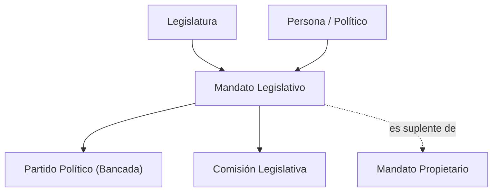

# Arquitectura de Proyecto Tlatoa

> **Plataforma de Transparencia Ciudadana, Fiscalización del Poder y Grafo de Conocimiento Político.**  
> Arquitectura multiplataforma, offline-first y de latencia ultra-baja sin dependencias de bases de datos pesadas.

---

## 1. Visión General de la Arquitectura

Proyecto Tlatoa opera como un ecosistema cívico desacoplado en tres capas: clientes de consulta inmediata (Android, Desktop y Web), núcleo de datos estructurados en JSON/SQLite FTS5, y canal de ingesta y preservación criptográfica.


### Principios Fundamentales de Diseño:
1. **Rendimiento Nativo y Offline-First:** Motor nativo en **Rust 2021** y base de datos compacta **SQLite FTS5** (`storage/tlatoa.db`), permitiendo búsquedas en texto completo en menos de **1 milisegundo** sin necesidad de internet ni datos móviles.
2. **Cero Bases de Datos Engorrosas:** Eliminación de servidores MySQL o PostgreSQL obligatorios. Toda la información histórica vive en **archivos JSON estructurados y versionados en Git** (`storage/data/json/`).
3. **Servidor Web Asíncrono de Alto Rendimiento:** Backend en **Python (FastAPI + Jinja2 + orjson)** con pre-indexación en memoria RAM para latencias de respuesta menores a 15 ms.
4. **Trazabilidad y Evidencia Criptográfica:** Cada registro político cuenta con un hash SHA-256 (`sha256_evidencia`) vinculado a fuentes oficiales primarias del Estado mexicano (`.gob.mx`).

---

## 2. Flujo de Datos y Sincronización Upstream

El proyecto se alimenta periódicamente de fuentes primarias gubernamentales y mantiene sincronización continua con el repositorio original **Pulso Cívico** (`elpulsocivico/pulso-civico`), aplicando parches selectivos sin sobreescribir personalizaciones locales:


---

## 3. Resumen Ejecutivo del Stack Tecnológico

| Capa | Tecnología | Justificación y Ventaja |
|---|---|---|
| **Capa Móvil (Android)** | **Kotlin + Jetpack Compose** | Aplicación nativa 100% offline, Material Design 3, enlace JNI a motor Rust y SQLite FTS5. |
| **Motor Nativo Offline & Desktop** | **Rust 2021 (FTS5 + tiny_http)** | Búsquedas en < 0.5 ms (`crates/tlatoa-core`), app de escritorio portable sin runtime de Python (`crates/tlatoa-desktop`). |
| **Backend Primario (Web)** | **Python 3.10+ (FastAPI + Uvicorn)** | Arquitectura asíncrona (ASGI) de latencia ultra-baja (< 15 ms), tipado estricto con Pydantic y pre-indexación en memoria de más de 3,200 datasets con `orjson`. |
| **Motor de Vistas** | **Jinja2 + HTML5 Semántico** | Renderizado server-side ultrarrápido, componentes modulares (`app/templates/partials/`), herencia de layouts y compatibilidad mobile-first. |
| **Almacenamiento y Datos** | **Datasets JSON (`storage/data/json/`)** | Cero motores de bases de datos pesados. Más de 16,000 actores públicos y 33,000 registros electorales auditables directamente en Git. |
| **Integridad & Fe Pública** | **Criptografía SHA-256** | Huella única (`sha256_evidencia`) ligada a fuentes oficiales (.gob.mx, POEs, DOF, SIL, INEGI). |

---

## 4. Modelo Conceptual: Grafo Ciudadano y Desacoplamiento Persona vs. Mandato

La identidad de un actor político trasciende a una sola legislatura. Para evitar duplicidades y permitir auditorías históricas a lo largo del tiempo, la plataforma desacopla la persona física de sus cargos temporales:

* **Entidad `politicos` (Persona Invariante):**  
  Representa a la persona física: nombre oficial, fotografía principal, semblanza curricular, escolaridad y slug permanente (`/politicos/{slug}`).
* **Entidad `mandatos_legislativos` (Cargo Temporal en una Legislatura):**  
  Representa el ejercicio del cargo en un periodo constitucional determinado:
  - Cámara (Diputados / Senadores / Congreso Local) y Legislatura (ej. LXVI).
  - Grupo parlamentario o bancada (permite rastrear el **"Detector de Chapulines"** y cambios de partido).
  - Principio de elección (Mayoría Relativa, Representación Proporcional, Primera Minoría).
  - Entidad federativa y distrito electoral.
  - Rol de mandato: **Propietario** o **Suplente**. Si es suplente, enlaza al mandato titular que cubre (`titular_mandato_id`).

### Relaciones del Grafo:


---

## 5. Estructura del Repositorio

```text
android/                 Aplicación móvil nativa (Kotlin + Jetpack Compose + JNI a Rust)
  app/src/main/java/     Código Kotlin (MainActivity, ViewModel, TlatoaEngine JNI)

crates/                  Ecosistema nativo en Rust (Compilación sin runtime de Python)
  tlatoa-core/           Motor de búsqueda offline ultra-rápido en Rust (SQLite FTS5, C-ABI y JNI)
  tlatoa-desktop/        Aplicación de escritorio todo-en-uno en Rust (tiny_http + webview/browser)

app/                     Núcleo activo de la plataforma web en Python (FastAPI)
  core/                  Configuración (config.py) y seguridad / rate limit (security.py)
  routers/               Rutas web (web.py), API REST (api.py) y auditoría (electoral.py)
  services/              Lógica de datos (data_service.py), auditoría (audit_service.py), educación (education_service.py)
  templates/             Vistas Jinja2 (home.html, politico.html, layouts y partials)

storage/                 Almacenamiento estático de datos abiertos y assets
  tlatoa.db              Base de datos SQLite optimizada con FTS5 (< 40 MB) para apps móviles y escritorio
  data/json/             Datasets ciudadanos publicados (3,200+ JSONs / 16,000+ actores públicos)
    municipios/          Historial electoral de 54 años y cabildos (2,474 JSONs)
    ejecutivo/           Gobernadores de 32 estados y CDMX (34 JSONs / 300 reg.)
  raw/photos/            Fotografías oficiales de legisladores

tools/                   Herramientas de línea de comandos, runner y ETL
  build_mobile_db.py     ETL para compilar datasets JSON a SQLite FTS5 para Android/Desktop
  sync_titulares_lxvi.py Sincronización e indexación de titulares y suplencias SIL
  build_universal_search_index.py Constructor de índice jerárquico de búsqueda
  audit_encoding.py      Auditor de codificación UTF-8 en datasets JSON
```

---

## 6. Rutas Web Principales

| Ruta | Motor | Descripción |
|---|---|---|
| `/` | FastAPI + Jinja2 | Portada interactiva, métricas nacionales, mapa ciudadano y buscador global (`Ctrl+K`) |
| `/politicos`, `/politicos/{slug}` | FastAPI + Jinja2 | Directorio nacional y expediente individual con historial de legislaturas y partidos |
| `/legislaturas`, `/legislaturas/{num}` | FastAPI + Jinja2 | Explorador histórico parlamentario (LXI a LXVI) |
| `/alcaldes`, `/municipios` | FastAPI + Jinja2 | Directorio de 2,474 presidentas y presidentes municipales en funciones |
| `/municipios/{cvegeo}` | FastAPI + Jinja2 | Expediente municipal con 54 años de elecciones (1970–2024) y cabildo |
| `/estados/{slug}` | FastAPI + Jinja2 | Ficha estatal (gobernador, congreso local y legisladores federales) |
| `/comisiones`, `/comisiones/{slug}` | FastAPI + Jinja2 | Comisiones legislativas y composición de integrantes |
| `/estudios`, `/estudios/{categoria}` | FastAPI + Jinja2 | Análisis de paridad de género, pluralidad y escolaridad parlamentaria |
| `/api/buscar`, `/api/politicos` | FastAPI (JSON) | API de autocompletado y búsqueda parametrizada |

---

## 🗺️ Navegación y Conexiones (Obsidian Graph)

* [[README|Índice Principal de Proyecto Tlatoa]]
* [[PLAN_RESILIENCIA_Y_PRESERVACION|Protocolo de Resiliencia, Integridad Criptográfica y Preservación Digital]]
* [[DATA_SCHEMA|Contratos de Datos y Esquemas JSON]]
* [[DICCIONARIO_DE_DATOS|Diccionario de Datos y Entidades]]
* [[FUENTES|Catálogo de Fuentes Primarias Gubernamentales]]
* [[ESTADOS_COBERTURA|Mapa de Cobertura de las 32 Entidades]]
* [[COMO_CREAR_UN_SCRAPER|Guía para Crear Scrapers]]
* [[SOLUCION_DE_PROBLEMAS|Guía de Solución de Problemas (Troubleshooting)]]
