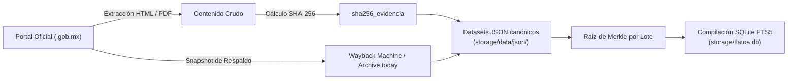

# Manual de Datos, Integridad y Evidencia Criptográfica

> **Proyecto Tlatoa** — Estándar de verificación técnica y fe pública digital para colaboradores y agentes de IA.

---

## 1. Principio Rector: La Fe Pública Digital

Proyecto Tlatoa es una plataforma antipartidista de fiscalización ciudadana. Para blindar el proyecto contra disputas de autenticidad o señalamientos de manipulación:

> **Todo dato oficial integrado a la plataforma debe contar con su correspondiente prueba criptográfica de existencia y respaldo fáctico.**

---

## 2. El Ciclo de Integridad de un Dato

Cuando un colaborador o un agente de IA desarrolla un extractor (scraper) o integra un nuevo dataset, debe seguir este flujo:



### 1. Extracción con Trazabilidad
* Al consultar un portal gubernamental (SIL, SITL, gacetas o diarios de debates), se calcula de inmediato su huella SHA-256.
* En Python:
  ```python
  import hashlib
  sha256 = hashlib.sha256(raw_bytes).hexdigest()
  ```

### 2. Estructuración en JSON Canónico
* Todo registro debe almacenarse con los campos obligatorios de metadatos:
  * `fuente_url`: URL oficial directa de la dependencia gubernamental (`.gob.mx`).
  * `sha256_evidencia`: Huella SHA-256 de 64 caracteres en minúsculas.
  * `fecha_extraccion`: Fecha en formato ISO (`YYYY-MM-DD`).

### 3. Agrupamiento e Integración
* Los datasets JSON se compilan en la base de datos de texto completo (`storage/tlatoa.db`) mediante `tools/build_mobile_db.py`.
* Cero bases de datos complejas obligatorias: todo el desarrollo local opera sobre los archivos JSON y la base SQLite compacta.

---

## 3. Checklist Obligatorio para PRs de Datos y Scrapers

Antes de enviar un Pull Request con nuevos datos:
1. [ ] **¿La fuente es 100% oficial?** (Dominio `.gob.mx`, congreso estatal, bando solemne o gaceta parlamentaria).
2. [ ] **¿Se calcula el `sha256_evidencia` del registro?** Ningún dato debe carecer de hash de evidencia.
3. [ ] **¿Se incluye `metadata.fuente_url` y `metadata.fecha_extraccion`?**
4. [ ] **¿Sin datos personales privados?** Prohibido incluir teléfonos personales, domicilios o datos familiares.
5. [ ] **¿Sintaxis y codificación verificadas?**
   ```bash
   python3 -m py_compile app/main.py tools/*.py
   python3 tools/audit_encoding.py
   ```

---

## 🗺️ Navegación y Conexiones (Obsidian Graph)

* [[README|Índice Principal de Proyecto Tlatoa]]
* [[DATA_SCHEMA|Contratos de Datos y Esquemas JSON]]
* [[DICCIONARIO_DE_DATOS|Diccionario de Datos y Entidades]]
* [[FUENTES|Catálogo de Fuentes Primarias Gubernamentales]]
* [[PLAN_RESILIENCIA_Y_PRESERVACION|Protocolo de Resiliencia y Preservación Digital]]
* [[COMO_CREAR_UN_SCRAPER|Guía para Crear un Scraper]]
* [[MANIFIESTO|Manifiesto Ético y Neutralidad]]
