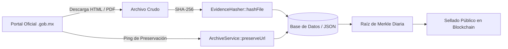

# MANUAL DE DATOS, INTEGRIDAD Y EVIDENCIA CRIPTOGRÁFICA
## Proyecto Tlatoa — Estándar para Colaboradores e Inteligencias Artificiales
**Versión:** 1.0 | **Ámbito:** Universal Open Source

---

## 1. PRINCIPIO RECTOR: LA FE PÚBLICA DIGITAL

Proyecto Tlatoa es una plataforma estrictamente antipartidista de transparencia política. Para blindar el proyecto contra acusaciones de manipulación, censura o alteración:

> **Todo dato oficial ingresado a la plataforma debe contar con su correspondiente prueba criptográfica de existencia y respaldo inmutable.**

---

## 2. EL CICLO DE INTEGRIDAD DE UN DATO (PASO A PASO)

Cuando un voluntario o un agente de IA escribe un extractor (scraper) o ingresa un nuevo dataset, debe seguir este flujo:



### 1. Extracción con Trazabilidad
- Al descargar una página del SIL o gaceta parlamentaria, se calcula su huella:
  ```php
  use Tlatoa\Core\EvidenceHasher;
  use Tlatoa\Core\ArchiveService;

  $sha256 = EvidenceHasher::hashContent($htmlCrudo);
  $archiveUrl = ArchiveService::getArchiveLookupUrl($urlOficial);
  ```

### 2. Guardado en Base de Datos o JSON
- Se almacena el registro con los campos obligatorios:
  - `source_url`: URL oficial directa de la dependencia del gobierno.
  - `sha256_hash`: Huella SHA-256 de 64 caracteres.
  - `archive_url`: Enlace histórico de Wayback Machine o snapshot.
  - `fecha_extraccion`: Fecha en formato ISO (`YYYY-MM-DD`).

### 3. Sellado por Raíz de Merkle (Merkle Root)
- Al finalizar el lote de extracción del día, el sistema agrupa todos los hashes calculados y produce una sola **Raíz de Merkle**:
  ```php
  $root = EvidenceHasher::computeMerkleRoot($arrayDeHashes);
  ```
- Esta raíz representa matemáticamente la totalidad de los datos del día. Puede ser sellada en redes de Capa 2 (Polygon, Base) por una fracción de centavo de dólar ($0.001 USD) o publicada en un commit de GitHub con firma GPG.

---

## 3. MODELO DE BASE DE DATOS Y PORTABILIDAD

El sistema incluye un conector agnóstico (`Tlatoa\Core\Database`):

### Para Colaboradores Locales y Pruebas Rápidas (Por defecto: SQLite)
- **Cero configuración requerida.**
- Al arrancar la aplicación (`php -S localhost:8000`), se crea automáticamente `storage/database.sqlite` con las tablas e índices listos.
- No necesitas configurar MySQL, contraseñas ni permisos locales.

### Para Producción o Entornos Robustos (MySQL / MariaDB)
- En tu archivo `.env`:
  ```ini
  DB_DRIVER=mysql
  DB_HOST=127.0.0.1
  DB_PORT=3306
  DB_DATABASE=tlatoa
  DB_USERNAME=root
  DB_PASSWORD=tu_password
  ```
- El esquema relacional completo se encuentra en `database/schema.sql`.

---

## 4. CHECKLIST OBLIGATORIO PARA PRs DE DATOS Y SCRAPERS

Antes de enviar un Pull Request con nuevos datos:
1. [ ] **¿La fuente es 100% oficial?** (Dominio `.gob.mx`, congreso local o diario de debates reconocido).
2. [ ] **¿Se calcula el `sha256` del contenido?** Ningún dato debe carecer de hash de evidencia.
3. [ ] **¿Se incluye `metadata.fuente_url` y `fecha_extraccion`?**
4. [ ] **¿Sintaxis verificada?** Ejecutar:
   ```bash
   php tools/gateway.php lint "src/Services/TuScraper.php"
   ```
