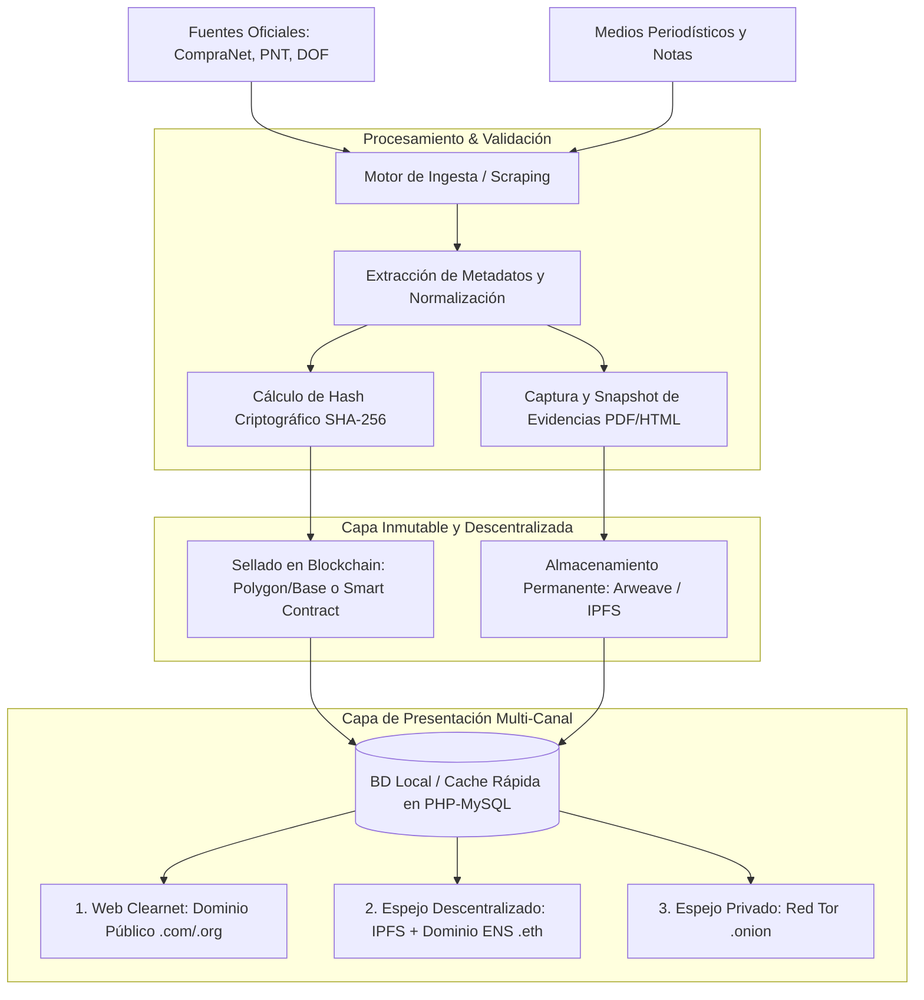

# ARQUITECTURA DE RESILIENCIA Y ANTI-CENSURA: PROYECTO TLATOA
**Plan Estratégico y Técnico Paso a Paso (Web3 / Respaldo Inmutable / Anonimato)**

---

## 1. Visión y Objetivos de Supervivencia
El objetivo de este plan es garantizar que **Proyecto Tlatoa** sea:
1. **Inapagable (Resistente a la censura):** Ningún actor (gobierno, ISP o proveedor de hosting) podrá tirar el sitio o borrar los datos.
2. **Inalterable (Prueba Criptográfica de Evidencia):** Cada contrato, licitación o dato oficial vinculado a notas periodísticas contará con sello de tiempo y hash matemático para evitar acusaciones de falsificación o alteración.
3. **Legal y Operativamente Seguro (OpSec & Zero-Liability):** Blindaje de identidad para los operadores y estructura de datos que actúe como "archivo y agregador objetivo", no como emisor de acusaciones.

---

## 2. Diagrama de Flujo de Datos

---

## 3. Plan Paso a Paso por Fases

### FASE 1: Preparación del Modelo de Datos y Criptografía Básica (Inmediata / Local)
*Objetivo: Que el código que ya estás desarrollando en PHP/MySQL esté listo para la blockchain sin necesidad de gastar dinero ni complicar la arquitectura actual.*

* [ ] **Paso 1.1: Esquema de Integridad en Base de Datos**
  * Añadir campos en las tablas principales (`contratos`, `noticias`, `vinculaciones`):
    * `sha256_hash` (CHAR 64): Huella digital del contenido o del documento oficial.
    * `source_url` (VARCHAR): URL de origen del gobierno o del medio.
    * `snapshot_cid` (VARCHAR 100, nullable): Identificador de contenido descentralizado (IPFS/Arweave).
    * `blockchain_tx` (VARCHAR 100, nullable): Hash de la transacción en blockchain.
* [ ] **Paso 1.2: Generador de Evidencias y Hashes en PHP**
  * Cada vez que se descargue un PDF o se archive un dato de gobierno, calcular su `hash_file('sha256', $rutaArchivo)`.
  * Guardar el archivo estructurado con timestamp ISO-8601 en `storage/evidence/`.
* [ ] **Paso 1.3: Redacción Legal Tipo Espejo (Anti-Difamación)**
  * Redactar las plantillas del sitio bajo el estándar:
    > *"El presente registro es una copia fiel del documento oficial emitido por [Dependencia] bajo el folio [Folio], el cual fue correlacionado con la cobertura informativa del medio [Medio] con fecha [Fecha]. Proyecto Tlatoa no emite juicio de valor sobre el contenido de dichas fuentes."*

---

### FASE 2: Archivado Inmutable y Permanente (Costos Mínimos / Respaldo)
*Objetivo: Que si el gobierno borra la página oficial de transparencia, la copia de Proyecto Tlatoa sea legalmente incuestionable e indestructible.*

* [ ] **Paso 2.1: Integración con Servicios de Archivado Web**
  * Automatizar llamadas API a servicios de snapshot en caliente:
    * Internet Archive (Wayback Machine API).
    * Archive.today.
* [ ] **Paso 2.2: Conexión con Redes Descentralizadas (Arweave / Pinata IPFS)**
  * Usar proveedores sencillos como **Pinata (IPFS)** o **Bundlr/Irys (Arweave)**:
    * Se envía el PDF del contrato oficial y el JSON de la correlación con la noticia.
    * Se obtiene un `CID` (Content Identifier) universalmente localizable y replicado en miles de nodos.
* [ ] **Paso 2.3: Visor Público de Prueba de Existencia**
  * En la interfaz web de cada nota o contrato, mostrar un botón:
    * *"Verificar autenticidad criptográfica"* (Muestra el SHA-256 y el enlace al nodo descentralizado).

---

### FASE 3: Sellado en Blockchain (Notarización Pública)
*Objetivo: Registrar las relaciones de forma inmutable a costo casi cero ($0.001 USD por registro).*

* [ ] **Paso 3.1: Selección de Red de Capa 2 (L2)**
  * Seleccionar una red rápida y económica como **Polygon**, **Base** u **Optimism**.
* [ ] **Paso 3.2: Batching de Hashes (Árbol de Merkle)**
  * En lugar de registrar cada noticia/contrato individualmente (que generaría miles de micro-transacciones), agrupar los hashes del día en un solo **Merkle Root**.
  * Una sola transacción al día en la blockchain sella la integridad de 100 o 1,000 registros procesados.
* [ ] **Paso 3.3: Script Autónomo de Sellado**
  * Un cron job que tome todos los registros del día, genere la raíz criptográfica y la guarde en un Smart Contract público de notarización.

---

### FASE 4: Blindaje de Acceso y Red Anti-Censura (D-Web & Tor)
*Objetivo: Si el gobierno mexicano ordena el bloqueo del dominio `.com` o presiona al proveedor de hosting, el público sigue teniendo acceso.*

* [ ] **Paso 4.1: Despliegue de Frontend Estático en IPFS + ENS**
  * Compilar una versión ligera del frontend (lectura de datos públicos) como archivos estáticos.
  * Adquirir un dominio **ENS** (Ethereum Name Service), por ejemplo `tlatoa.eth`.
  * Asociar el dominio ENS al CID de IPFS.
  * El sitio se vuelve accesible automáticamente en navegadores como Brave, Opera o mediante pasarelas descentralizadas (`tlatoa.eth.limo`).
* [ ] **Paso 4.2: Servicio Oculto en Tor (.onion)**
  * Levantar un espejo en la red Tor.
  * Permite el acceso anónimo de periodistas y ciudadanos sin rastreo de IP ni riesgo de bloqueo por parte de los operadores de telecomunicaciones nacionales.
* [ ] **Paso 4.3: Exportación de Datos en Formato Torrent / Datasets Abiertos**
  * Semanalmente o mensualmente, generar un archivo `.torrent` o dump de SQLite abierto que la comunidad de periodistas y activistas pueda descargar y replicar en sus propias computadoras.

---

### FASE 5: Protocolo de Seguridad Operativa (OpSec)
*Objetivo: Mantener a salvo a los desarrolladores y creadores del proyecto.*

* [ ] **Paso 5.1: Anonimización de Infraestructura**
  * Contratar dominios y servicios con protección Whois completa y pagos independientes / cripto cuando sea necesario.
  * Cero correos personales o números telefónicos asociados a los servidores y repositorios.
* [ ] **Paso 5.2: Política de Cero Registros (Zero Logs)**
  * Configurar Apache / Nginx para **desactivar los registros de IP de visitantes** (`access.log` configurado con IPs anonimizadas o desactivado por completo).
  * No solicitar correos electrónicos ni inicios de sesión a usuarios comunes para ver la información.
* [ ] **Paso 5.3: Alianzas con Organizaciones de Protección a Periodistas**
  * Presentar la herramienta a colectivos como *Artículo 19*, *R3D (Red en Defensa de los Derechos Digitales)* o *CONNECTAS*.
  * Respaldar el proyecto bajo el cobijo de organizaciones civiles de transparencia y periodismo de investigación para disuadir represalias unilaterales.
