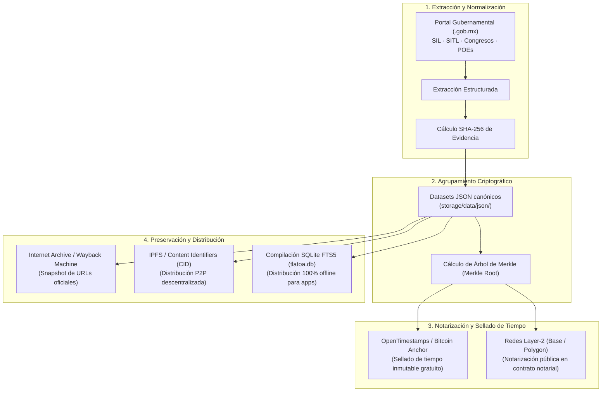

# Protocolo de Resiliencia, Integridad Criptográfica y Preservación Digital

> **Proyecto Tlatoa** — Estándar de integridad de datos, notarización distribuida y preservación histórica para la fiscalización ciudadana en México.

---

## 1. Misión y Fundamento Técnico

El propósito de este protocolo es dotar a los datos cívicos y parlamentarios de México de tres garantías esenciales:
1. **Autenticidad e Integridad Fáctica:** Todo registro oficial cuenta con una huella criptográfica SHA-256 (`sha256_evidencia`) que permite verificar matemáticamente que el contenido no ha sido alterado desde su publicación original.
2. **Preservación Digital Permanente:** Los documentos, gacetas y acuerdos gubernamentales suelen modificarse o eliminarse tras los cambios de administración sexenales o trienales. El protocolo establece mecanismos de snapshot y archivado distribuido para salvaguardar la memoria histórica.
3. **Disponibilidad Soberana (Offline-First):** La base de datos completa reside localmente en el dispositivo del usuario final (Android y Desktop), permitiendo auditorías independientes sin dependencia de servidores centrales ni conexión continua a internet.

---

## 2. Flujo de Integridad y Notarización

---

## 3. Pilares del Protocolo de Preservación

### A. Trazabilidad Criptográfica SHA-256 y Árboles de Merkle
* Cada archivo de legislador, votación, asistencia o mandatario contiene un bloque de metadatos obligatorio:
  * `fuente_url`: Enlace directo y oficial a la dependencia emisora (`.gob.mx`).
  * `fecha_extraccion`: Fecha ISO-8601 del momento de consulta.
  * `sha256_evidencia`: Hash hexadecimal de 64 caracteres calculado a partir del contenido del registro.
* **Agrupamiento por Árbol de Merkle (Merkle Tree):**
  * Para evitar transacciones masivas individuales, los hashes de los registros se agrupan en una estructura de árbol binario de Merkle.
  * Una sola raíz criptográfica (`merkle_root`) de 32 bytes sella matemáticamente decenas de miles de registros en una sola operación.

### B. Pruebas de Existencia y Notarización Pública
* **OpenTimestamps (Estándar Primario):**
  * Protocolo descentralizado de código abierto que ancla la raíz de Merkle en la cadena de bloques de Bitcoin sin generar costos de tarifas individuales.
  * Genera archivos de recibo criptográfico (`.ots`) que cualquier auditor o periodista puede verificar de forma independiente mediante herramientas CLI estándar.
* **Notarización en Redes Layer-2 (L2):**
  * Anclaje periódico de la raíz de Merkle en contratos inteligentes ligeros de registro público (sobre redes como Polygon o Base) con costos de gas inferiores a $0.005 USD por emisión.
  * Permite auditorías en exploradores de bloques públicos transparentes y accesibles a cualquier navegador web.

### C. Estrategia de Archivado Web y Respaldo P2P
* **Snapshotting Automatizado en Archivos Web Institucionales:**
  * Al ingresar una nueva fuente oficial, se solicita automáticamente su indexación en la **Wayback Machine** (Internet Archive) y **Archive.today**.
  * Si la página gubernamental queda fuera de línea en el futuro, el usuario cuenta con el enlace alterno de preservación verificado.
* **Red InterPlanetary File System (IPFS) y Redes de Contenido:**
  * Publicación de los paquetes mensuales de datos en IPFS mediante Identificadores de Contenido (CID).
  * Los CIDs son inmutables: si un solo carácter del dataset cambia, el CID cambia, garantizando la inmutabilidad de cada versión distribuida.
* **Distribución de Datasets vía BitTorrent:**
  * Publicación periódica de snapshots de la base de datos `tlatoa.db` vía enlaces Magnet / torrent para descarga y alojamiento comunitario por colectivos y universidades.

### D. Soberanía de Datos y Operación Offline
* La arquitectura de Proyecto Tlatoa prioriza que los datos residan en el terminal del ciudadano:
  * Aplicación nativa Android (Kotlin + Rust FTS5): 100% operativa sin conexión celular.
  * Aplicación de escritorio portable (Rust): Búsqueda local en milisegundos sin llamadas a servidores externos.
  * Esta arquitectura elimina el riesgo de interrupción de servicio por saturación de servidores o caídas de infraestructura en la nube.

---

## 4. Prácticas de Privacidad y Operación Ética

1. **Datos Exclusivamente Públicos:** No se registra ningún dato de carácter personal privado; la cobertura se limita rigurosamente a atribuciones, votaciones, trayectoria y remuneraciones de servidores públicos emanados de documentos oficiales.
2. **Neutralidad de Registro:** La plataforma actúa exclusivamente como archivo de fe pública digital y agregador fáctico. Cero adjetivos, juicios morales o sesgos partidistas.
3. **Política de Cero Registros (Zero-Logging):** El servidor local FastAPI y los nodos comunitarios operan sin almacenar direcciones IP de los usuarios ni generar perfiles de navegación ciudadana.

---

## 🗺️ Navegación y Conexiones (Obsidian Graph)

* [[README|Índice Principal de Proyecto Tlatoa]]
* [[ARQUITECTURA|Arquitectura del Sistema y Grafo de Conocimiento]]
* [[MANIFIESTO|Manifiesto Ético y Principios de Neutralidad]]
* [[DATA_SCHEMA|Contratos de Datos y Esquemas JSON]]
* [[FUENTES|Catálogo de Fuentes Primarias Gubernamentales]]
* [[PLAN_RESILIENCIA_BLOCKCHAIN|Documento Histórico de Resiliencia Web3]]
