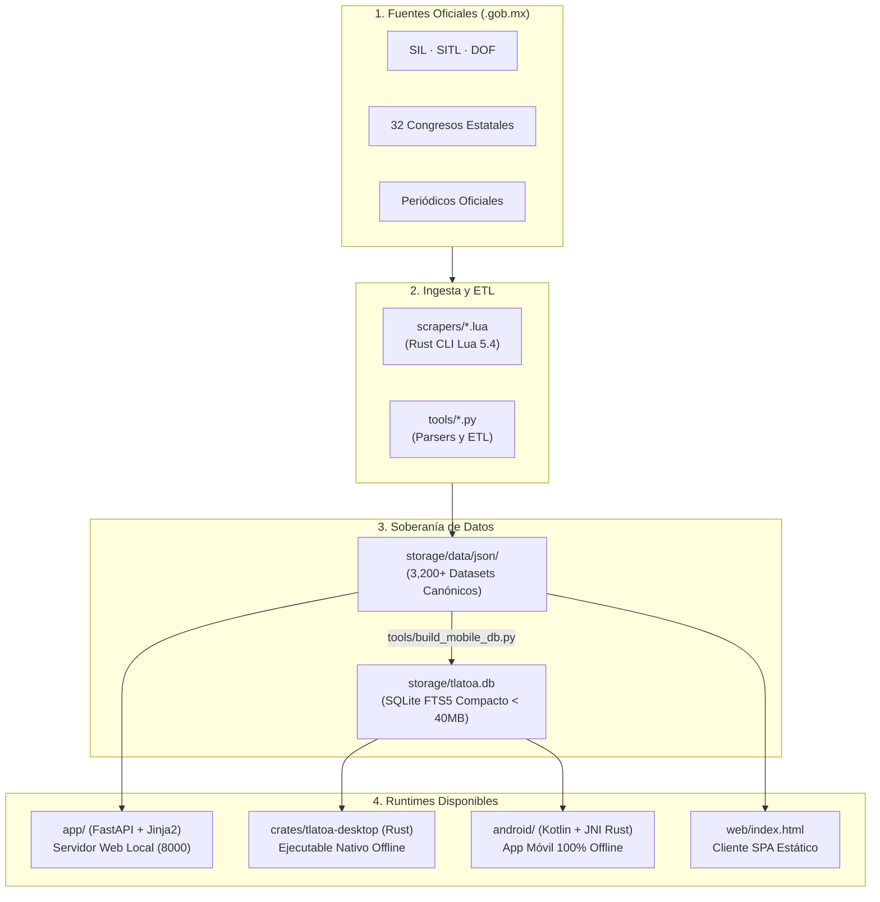

# Guía Técnica de Arquitectura y Estructura del Repositorio — Proyecto Tlatoa

> **Documento Maestro (`index.md`)**  
> Fuente de consulta técnica obligatoria para desarrolladores, colaboradores y agentes de IA. Describe la constitución completa del repositorio, la función exacta de cada carpeta y archivo, los runtimes activos y las normas de desarrollo.

---

## 1. Visión General y Constitución Técnica

**Proyecto Tlatoa** es una plataforma ciudadana independiente de datos abiertos y auditoría cívica sobre el poder público en México. Su arquitectura está orientada a la **soberanía de datos**, **operación desconectada (offline-first)** y **alta velocidad (< 1 ms por consulta)** mediante tres componentes centrales:



---

## 2. Archivos Esenciales en la Raíz del Proyecto

Para garantizar máxima claridad, la raíz del repositorio se reserva **únicamente para archivos esenciales** de configuración, entrada y gobernanza. Todo lo demás se organiza en sus respectivos directorios temáticos.

| Archivo | Función y Propósito |
|---|---|
| [`index.md`](index.md) | **Este documento:** Mapa exhaustivo del proyecto, detalle de archivos y guía técnica. |
| [`README.md`](README.md) | Portada principal del observatorio cívico, resumen de impacto y enlaces comunitarios. |
| [`AGENTS.md`](AGENTS.md) | Directivas inviolables para asistentes de Inteligencia Artificial (Claude, Gemini, ChatGPT, Codex, Cursor). |
| [`LICENSE`](LICENSE) | Licencia legal del código fuente: **GNU Affero General Public License v3.0 (AGPL-3.0)**. |
| [`requirements.txt`](requirements.txt) | Especificación de dependencias mínimas de Python (`fastapi`, `uvicorn`, `jinja2`, `orjson`, `pydantic`). |
| [`Dockerfile`](Dockerfile) | Manifiesto de compilación de contenedor Docker para despliegue web homogéneo. |
| [`docker-compose.yml`](docker-compose.yml) | Definición para levantar el entorno web local contenerizado en el puerto `8000`. |
| [`iniciar_tlatoa.sh`](iniciar_tlatoa.sh) | Script bash para ejecutar la aplicación de escritorio nativa en Linux/macOS con un solo clic. |
| [`.env`](.env) / [`.env.example`](.env.example) | Variables de entorno (puertos, debug, directorios de fotos y almacenamiento). |
| [`.gitignore`](.gitignore) | Reglas de exclusión de Git (entornos virtuales `.venv`, cachés, base de datos temporal, etc.). |

---

## 3. Mapa Exhaustivo de Carpetas y Archivos

A continuación se detalla cada directorio del proyecto y el propósito específico de cada archivo que lo compone.

### 📱 `android/` — Aplicación Móvil Nativa (Android)
Aplicación Android 100% desconectada construida con **Kotlin + Jetpack Compose** que consume el motor Rust embebido (`tlatoa-core`) vía JNI.

* [`build.gradle.kts`](android/build.gradle.kts): Configuración raíz de compilación Gradle del proyecto Android.
* [`settings.gradle.kts`](android/settings.gradle.kts): Declaración de módulos y repositorios de dependencias Android.
* [`gradle.properties`](android/gradle.properties): Parámetros de la JVM y optimizaciones para Gradle.
* `gradle/`:
  * [`libs.versions.toml`](android/gradle/libs.versions.toml): Catálogo canónico de versiones y librerías de Compose, Kotlin y AndroidX.
* `app/`:
  * [`build.gradle.kts`](android/app/build.gradle.kts): Dependencias y configuración del módulo de aplicación Android.
  * [`proguard-rules.pro`](android/app/proguard-rules.pro): Reglas de optimización y ofuscación R8 para release.
  * `src/main/`:
    * [`AndroidManifest.xml`](android/app/src/main/AndroidManifest.xml): Manifiesto del sistema (pantalla principal, intents, permisos cero).
    * `java/org/tlatoa/`:
      * `core/`:
        * [`TlatoaEngine.kt`](android/app/src/main/java/org/tlatoa/core/TlatoaEngine.kt): Puente JNI que invoca la biblioteca Rust (`tlatoa_core`) para consultas SQLite FTS5 instantáneas.
      * `data/`:
        * [`Politico.kt`](android/app/src/main/java/org/tlatoa/data/Politico.kt): Modelo de datos inmutable para representar legisladores y mandatarios en Kotlin.
      * `ui/`:
        * [`MainActivity.kt`](android/app/src/main/java/org/tlatoa/ui/MainActivity.kt): Pantalla y buscador interactivo en Jetpack Compose.
        * `theme/`:
          * [`Color.kt`](android/app/src/main/java/org/tlatoa/ui/theme/Color.kt): Paleta oficial de colores de Proyecto Tlatoa y partidos políticos.
          * [`Theme.kt`](android/app/src/main/java/org/tlatoa/ui/theme/Theme.kt): Tema Material 3 adaptativo con soporte para modo oscuro.

---

### 🌐 `app/` — Servidor Web Activo (Python / FastAPI)
Núcleo del backend web asíncrono que sirve las vistas Jinja2 y la API REST local.

* [`main.py`](app/main.py): Configuración de FastAPI, middlewares de CORS, montaje de rutas estáticas (`/assets`, `/photos`, `/actas`) y arranque con Uvicorn.
* [`__init__.py`](app/__init__.py): Inicializador del paquete Python.
* `core/`:
  * [`config.py`](app/core/config.py): Gestión de variables de configuración, rutas de almacenamiento y ajustes del sistema mediante Pydantic.
  * [`security.py`](app/core/security.py): Funciones de saneamiento de entradas y cabeceras de seguridad.
  * [`__init__.py`](app/core/__init__.py): Inicializador del módulo.
* `routers/`:
  * [`web.py`](app/routers/web.py): Controlador de todas las vistas HTML Jinja2 (`/`, `/politicos`, `/legislaturas`, `/estudios`, `/comisiones`, `/electoral`, `/sitemap.xml`, `/robots.txt`, `/llms.txt`, etc.).
  * [`api.py`](app/routers/api.py): Endpoints JSON públicos (`/api/politicos`, `/api/estudios`, etc.).
  * [`electoral.py`](app/routers/electoral.py): Endpoints de auditoría electoral ciudadana y carga segura de actas de casilla.
  * [`__init__.py`](app/routers/__init__.py): Inicializador del módulo.
* `services/`:
  * [`data_service.py`](app/services/data_service.py): Servicio central de datos; carga en RAM con `orjson` los más de 3,200 datasets JSON, normaliza nombres, resuelve el histórico de partidos ("chapulineo") y comisiones.
  * [`education_service.py`](app/services/education_service.py): Normalizador curricular que clasifica grados académicos (Doctorado, Maestría, Licenciatura, etc.).
  * [`audit_service.py`](app/services/audit_service.py): Auditor de evidencias y registro de reportes ciudadanos.
  * [`image_service.py`](app/services/image_service.py): Procesamiento, compresión y cálculo de hash criptográfico SHA-256 para actas ciudadanas.
  * [`__init__.py`](app/services/__init__.py): Inicializador del módulo.
* `schemas/`:
  * [`legislador.py`](app/schemas/legislador.py): Esquemas Pydantic para validación y serialización de legisladores.
  * [`acta.py`](app/schemas/acta.py): Esquemas Pydantic para el modelo de datos de actas electorales.
  * [`__init__.py`](app/schemas/__init__.py): Inicializador del módulo.
* `templates/`:
  * [`layout/base.html`](app/templates/layout/base.html): Plantilla maestra Jinja2 con encabezado, buscador `Ctrl+K`, navegación y pie de página.
  * [`home.html`](app/templates/home.html): Portada con métricas nacionales, buscador en tiempo real y mapa de la República.
  * [`politicos.html`](app/templates/politicos.html): Directorio interactivo nacional de legisladores y representantes con filtros facetados.
  * [`politico.html`](app/templates/politico.html): Expediente individual completo (trayectoria, asistencias, votaciones, suplencias, grado académico).
  * [`legislaturas_index.html`](app/templates/legislaturas_index.html): Explorador histórico de legislaturas federales (LXI a LXVI).
  * [`comisiones.html`](app/templates/comisiones.html) / [`comision.html`](app/templates/comision.html): Listado y expediente individual de comisiones del Congreso de la Unión.
  * [`estado.html`](app/templates/estado.html): Radiografía por entidad federativa (diputados federales, senadores y congreso local).
  * [`estudios.html`](app/templates/estudios.html): Análisis académico y curricular del Congreso Mexicano.
  * [`electoral.html`](app/templates/electoral.html): Plataforma ciudadana descentralizada de auditoría y respaldo de actas de casilla.
  * [`explorador.html`](app/templates/explorador.html): Visor dinámico de datasets.
  * [`metodologia.html`](app/templates/metodologia.html): Criterios de normalización y rigor metodológico de los datos.
  * [`desarrolladores.html`](app/templates/desarrolladores.html): Portal web interactivo para nuevos programadores con ejemplos de CLI y prompts.
  * `partials/`:
    * [`card_politico.html`](app/templates/partials/card_politico.html): Componente reutilizable de tarjeta de legislador.
    * [`card_estudios.html`](app/templates/partials/card_estudios.html): Componente de resumen académico.
    * [`modal_reporte.html`](app/templates/partials/modal_reporte.html): Ventana modal para reportar fe de erratas o anomalías en datos.
  * [`README.md`](app/templates/README.md): Documento explicativo de las plantillas Jinja2 y su relación con el frontend estático.

---

### 🎨 `assets/` — Recursos Estáticos y Manifiestos Web
Archivos públicos servidos por FastAPI bajo la ruta `/assets/` y archivos de indexación web.

* [`favicon.ico`](assets/favicon.ico) / [`favicon.svg`](assets/favicon.svg): Iconos del observatorio para navegadores.
* [`robots.txt`](assets/robots.txt): Reglas de rastreo optimizadas para motores de búsqueda y bots de Inteligencia Artificial (GPTBot, Claude, Gemini). Servido en `/robots.txt`.
* [`site.webmanifest`](assets/site.webmanifest): Manifiesto PWA para instalación de la plataforma como aplicación web. Servido en `/site.webmanifest`.
* [`llms.txt`](assets/llms.txt): Manifiesto estandarizado según la especificación de `llmstxt.org` para orientar modelos de lenguaje sobre la naturaleza del sitio. Servido en `/llms.txt`.
* [`banner.png`](assets/banner.png): Banner panorámico oficial del observatorio cívico para el README.
* [`tecolote.png`](assets/tecolote.png) / [`tecolote.jpeg`](assets/tecolote.jpeg): Avatar e imagotipo de la mascota oficial.
* [`og-cover.png`](assets/og-cover.png): Portada OpenGraph para redes sociales y vistas previas.
* [`modelo_relacional.png`](assets/modelo_relacional.png) / [`modelo_relacional.svg`](assets/modelo_relacional.svg): Diagrama de entidad-relación de la base de datos de Proyecto Tlatoa.
* [`Mapa_CDMX.png`](assets/Mapa_CDMX.png): Mapa cartográfico auxiliar de las alcaldías de la Ciudad de México.
* `img/`:
  * [`tecolote.svg`](assets/img/tecolote.svg) / [`tecolote.png`](assets/img/tecolote.png): Arte vectorial en Pixel Art del Tecolote de la Transparencia (mascota oficial).
  * `legislaturas/`: Escudos y logotipos vectoriales de las legislaturas federales ([`leg-57.svg`](assets/img/legislaturas/leg-57.svg) hasta [`leg-66.svg`](assets/img/legislaturas/leg-66.svg)).

---

### ⚙️ `bin/` — Binarios y Ejecutables Nativos
Directorio destinado a almacenar ejecutables y artefactos binarios compilados listos para distribución portable.

* [`tlatoa-desktop`](bin/tlatoa-desktop): Ejecutable nativo pre-compilado en Rust para Linux x86_64. No requiere Python ni dependencias externas; integra un servidor web ligero y consulta instantáneamente `storage/tlatoa.db`.

---

### 🦀 `crates/` — Núcleo en Rust (Multiplataforma)
Espacio de trabajo modular en Rust que garantiza máxima velocidad de ejecución y portabilidad sin dependencias en Linux, Windows, macOS y Android.

* `tlatoa-core/`: Biblioteca central compartida y CLI.
  * [`Cargo.toml`](crates/tlatoa-core/Cargo.toml) / [`Cargo.lock`](crates/tlatoa-core/Cargo.lock): Dependencias del motor (`rusqlite` con FTS5, `mlua` para Lua 5.4, `serde`, `jni`).
  * `src/`:
    * [`lib.rs`](crates/tlatoa-core/src/lib.rs): Motor de búsqueda tolerante a acentos sobre SQLite FTS5 y exportación de funciones JNI para Android.
    * [`main.rs`](crates/tlatoa-core/src/main.rs): Punto de entrada para el comando CLI `tlatoa-cli` (comandos `search`, `status`, `scrape`).
    * [`scraper.rs`](crates/tlatoa-core/src/scraper.rs): Runtime embebido en Lua 5.4 con sandbox seguro y funciones globales `tlatoa.*`.
* `tlatoa-desktop/`: Aplicación de escritorio portable.
  * [`Cargo.toml`](crates/tlatoa-desktop/Cargo.toml) / [`Cargo.lock`](crates/tlatoa-desktop/Cargo.lock): Dependencias (`tlatoa-core`, `tiny_http`, `urlencoding`, `open`).
  * `src/`:
    * [`main.rs`](crates/tlatoa-desktop/src/main.rs): Servidor HTTP local multi-hilo en Rust que abre automáticamente el navegador del usuario y resuelve peticiones con latencia menor a 1 milisegundo.
    * [`ui.html`](crates/tlatoa-desktop/src/ui.html): Interfaz web moderna embebida directamente en el ejecutable binario mediante `include_str!`.

---

### 🗄️ `database/` — Esquemas SQL y Migraciones
Definición de las estructuras relacionales y de texto completo para SQLite.

* [`schema.sql`](database/schema.sql): Esquema DDL canónico de la base de datos (tablas `politicos`, `mandatos`, `comisiones`, `municipios`, `actas` e índices FTS5 `politicos_fts`).
* `migrations/`:
  * [`002_asistencias_votaciones.sql`](database/migrations/002_asistencias_votaciones.sql): Script de migración SQL para el registro granular de votaciones y asistencias legislativas.

---

### 📚 `docs/` — Documentación Técnica, Legal e Histórica
Repositorio central de documentación técnica interconectada mediante enlaces canónicos de Obsidian.

* Archivos Técnicos Principales:
  * [`ARQUITECTURA.md`](docs/ARQUITECTURA.md): Arquitectura completa del sistema, modelo de grafo ciudadano y desacoplamiento persona vs. mandato.
  * [`DATA_SCHEMA.md`](docs/DATA_SCHEMA.md): Contratos canónicos de datos y especificación de campos JSON (`snake_case`, UTF-8).
  * [`DICCIONARIO_DE_DATOS.md`](docs/DICCIONARIO_DE_DATOS.md): Diccionario de datos de todas las entidades, tablas, campos y relaciones.
  * [`FUENTES.md`](docs/FUENTES.md): Catálogo de fuentes primarias gubernamentales (.gob.mx) con su URL oficial y cobertura.
  * [`ESTADOS_COBERTURA.md`](docs/ESTADOS_COBERTURA.md): Tabla de avance y cobertura de los 32 congresos locales de México.
  * [`COMO_CREAR_UN_SCRAPER.md`](docs/COMO_CREAR_UN_SCRAPER.md): Guía práctica para programar extractores parlamentarios en Lua (`scrapers/`) o Python (`tools/`).
  * [`MANIFIESTO.md`](docs/MANIFIESTO.md): Manifiesto ético del proyecto: neutralidad fáctica absoluta, datos oficiales y filosofía de código abierto.
  * [`MANUAL_DE_DATOS_Y_EVIDENCIA.md`](docs/MANUAL_DE_DATOS_Y_EVIDENCIA.md): Estándar de integridad de datos, fe pública digital y verificación de hashes SHA-256.
  * [`PIPELINE_STAGING.md`](docs/PIPELINE_STAGING.md): Protocolo para el buzón de evidencias ciudadanas sin necesidad de programar.
  * [`PLAN_RESILIENCIA_Y_PRESERVACION.md`](docs/PLAN_RESILIENCIA_Y_PRESERVACION.md): Protocolo de resiliencia, sellado de tiempo criptográfico, snapshots y preservación histórica.
  * [`PLAYBOOK_LOCALES.md`](docs/PLAYBOOK_LOCALES.md): Playbook de extracción asistida por IA para congresos locales y alcaldías.
  * [`PODER_EJECUTIVO_ESTADOS.md`](docs/PODER_EJECUTIVO_ESTADOS.md): Modelo de datos y cobertura de los mandatarios estatales (1929–2030).
  * [`SOLUCION_DE_PROBLEMAS.md`](docs/SOLUCION_DE_PROBLEMAS.md): Guía de solución de problemas para Android, Windows, Linux y el servidor web.
* `legal/` — Licencias y Marco Legal:
  * [`DATA_LICENSE.md`](docs/legal/DATA_LICENSE.md): Licencia de datos abiertos Creative Commons Atribución 4.0 Internacional (CC BY 4.0).
  * [`NOTICE.md`](docs/legal/NOTICE.md): Aviso legal de atribución, deslinde antipartidista y reconocimiento de derechos de autor.
* `historial/` — Memoria Técnica y Migración:
  * [`HISTORIAL_MIGRACION.md`](docs/historial/HISTORIAL_MIGRACION.md): Bitácora de resolución de anomalías estructurales históricas (DF vs CDMX, duplicidad federal).
  * [`RESUMEN_TRANSFORMACION.md`](docs/historial/RESUMEN_TRANSFORMACION.md): Resumen de la demolición del código legacy, eliminación de candados y transición hacia Python + Rust.
  * `kineyo/`:
    * [`REPORTE_ESTADO_CONGRESOS.md`](docs/historial/kineyo/REPORTE_ESTADO_CONGRESOS.md): Auditoría histórica de la cobertura estatal previa a la bifurcación.
    * [`TAREAS_Y_CONTRIBUCIONES.md`](docs/historial/kineyo/TAREAS_Y_CONTRIBUCIONES.md): Archivo histórico de tareas de contribución iniciales.
* `img/`:
  * [`arquitectura_proyecto_tlatoa.svg`](docs/img/arquitectura_proyecto_tlatoa.svg): Diagrama SVG de la arquitectura multiplataforma.
  * [`flujo_sincronizacion_pulso_civico.svg`](docs/img/flujo_sincronizacion_pulso_civico.svg): Diagrama SVG del pipeline de sincronización de datos.

---

### 🤝 `.github/` — Gobernanza Comunitaria y Automatización (CI/CD)
Políticas de colaboración de GitHub, plantillas de reporte y flujos automáticos de integración continua.

* [`CODE_OF_CONDUCT.md`](.github/CODE_OF_CONDUCT.md): Código de conducta comunitario de convivencia y respeto mutuo.
* [`CONTRIBUTING.md`](.github/CONTRIBUTING.md): Guía para colaboradores sobre cómo abrir Issues, formatear código y enviar Pull Requests.
* [`SECURITY.md`](.github/SECURITY.md): Política de divulgación responsable de vulnerabilidades y seguridad del proyecto.
* [`pull_request_template.md`](.github/pull_request_template.md): Lista de verificación obligatoria para enviar Pull Requests.
* [`dependabot.yml`](.github/dependabot.yml): Configuración de alertas de actualización de dependencias de GitHub.
* `ISSUE_TEMPLATE/`: Plantillas estructuradas de GitHub:
  * [`bug.yml`](.github/ISSUE_TEMPLATE/bug.yml): Reporte de fallas en software o aplicaciones.
  * [`dato_erroneo.yml`](.github/ISSUE_TEMPLATE/dato_erroneo.yml): Notificación de incongruencias en datos gubernamentales.
  * [`fe_de_erratas.yml`](.github/ISSUE_TEMPLATE/fe_de_erratas.yml): Solicitud formal de corrección documental.
  * [`nueva_fuente.yml`](.github/ISSUE_TEMPLATE/nueva_fuente.yml): Propuesta de inclusión de una nueva fuente oficial (.gob.mx).
  * [`idea.yml`](.github/ISSUE_TEMPLATE/idea.yml): Propuestas de mejoras o nuevas funcionalidades.
  * [`adopcion_congreso.yml`](.github/ISSUE_TEMPLATE/adopcion_congreso.yml): Solicitud de adopción para extracción de un congreso local.
* `workflows/`: Acciones automáticas de GitHub Actions:
  * [`ci.yml`](.github/workflows/ci.yml): Integración continua (validación de sintaxis Python, formato y compilación).
  * [`desktop-release.yml`](.github/workflows/desktop-release.yml): Compilación y empaquetado automático de ejecutables nativos para Windows, Linux y macOS.
  * [`android-release.yml`](.github/workflows/android-release.yml): Compilación del APK nativo de Android.

---

### 🕷️ `scrapers/` — Extractores en Lua (Motor Rust)
Extractores legislativos de alta velocidad ejecutados por el CLI de Rust.

* [`template.lua`](scrapers/template.lua): Plantilla lista para usar con llamadas a `tlatoa.http_get()`, parseo de HTML y generación de JSON canónico.
* [`README.md`](scrapers/README.md): Instrucciones completas para compilar el motor CLI y correr extractores en Lua.

---

### 💾 `storage/` — Datos Abiertos, Base de Datos y Cachés
Almacén persistente local de datos públicos y cachés de trabajo.

* [`tlatoa.db`](storage/tlatoa.db): Base de datos SQLite optimizada (< 40 MB) con índice FTS5 de texto completo, utilizada directamente por Android y Desktop.
* [`sample_catalog.json`](storage/sample_catalog.json): Catálogo representativo reducido para pruebas rápidas de búsqueda.
* `data/`:
  * `json/`: Más de 3,200 datasets JSON estructurados:
    * `congreso_union_leg_*.json`: Diputados y senadores federales por legislatura (LXI a LXVI).
    * `congreso_<estado>_leg_*.json`: Legislaturas de los 32 congresos estatales.
    * `asistencias_*.json` / `votaciones_*.json`: Votaciones nominales y registros de asistencia parlamentaria.
    * `tabuladores_cargos_oficiales.json`: Sueldos y compensaciones oficiales verificadas.
    * `alcaldes/`: Directorio nacional de alcaldes y presidentes municipales vigentes.
    * `ejecutivo/`: Gobernadores históricos y vigentes de las 32 entidades federativas.
    * `municipios/`: 2,474 archivos JSON con historial electoral y conformación de cabildos municipales.
    * `catalogos/`: Catálogos maestros de legislaturas, alcaldes destacados y estudios.
  * [`mexico_paths.json`](storage/data/mexico_paths.json): Coordenadas vectoriales SVG de los 32 estados de la República Mexicana.
  * `auditoria/`: Registro de sumas criptográficas SHA-256 de auditoría.
* `raw/`:
  * `photos/`: Fotografías oficiales de representantes públicos organizadas por legislatura y cargo.
  * `html/`: Descargas HTML originales para certificar la reproducibilidad fáctica de los datos.
* `staging/`: Directorio temporal para la recepción de actas y datos pendientes de procesar.
* `cache/`: Caché local de descargas intermedias de red.
* `logs/`: Archivos de registro de ejecución de procesos ETL y servidores locales.

---

### 🛠️ `tools/` — Herramientas CLI, Parsers y Pipeline ETL
Scripts en Python para compilar bases de datos, normalizar texto y auditar la calidad de los datos.

* [`build_mobile_db.py`](tools/build_mobile_db.py): **ETL fundamental:** Lee los más de 3,200 archivos JSON en `storage/data/json/` y compila la base de datos binaria `storage/tlatoa.db` con tablas FTS5.
* [`build_pages_site.py`](tools/build_pages_site.py): Compilador del sitio estático para GitHub Pages; extrae el índice compacto `pages/data/search_index.json` y sincroniza assets.
* [`audit_encoding.py`](tools/audit_encoding.py): Escáner de codificación; detecta mojibake, caracteres de reemplazo o anomalías UTF-8 en los datasets JSON.
* [`sync_titulares_lxvi.py`](tools/sync_titulares_lxvi.py): Sincronizador de titulares y suplencias de la LXVI Legislatura Federal.
* [`build_universal_search_index.py`](tools/build_universal_search_index.py): Generador de índices de búsqueda jerárquica para consultas ultrarrápidas.
* [`enrich_birthdates.py`](tools/enrich_birthdates.py): Herramienta para incorporar fechas de nacimiento oficiales desde el SIL.
* [`enrich_directorio_politicos.py`](tools/enrich_directorio_politicos.py): Agregador de semblanzas y trayectorias curriculares.
* [`mapear_anomalias_nombres.py`](tools/mapear_anomalias_nombres.py): Limpiador y normalizador fonético de nombres propios para evitar perfiles duplicados.
* [`run.ps1`](tools/run.ps1): Runner centralizado en PowerShell para entornos Windows (`health`, `lint`, `git:status`).
* `core/`:
  * [`coahuila_parser.py`](tools/core/coahuila_parser.py): Parser especializado para la estructura tabular del Congreso de Coahuila.
  * [`nl_pdf_parser.py`](tools/core/nl_pdf_parser.py): Extractor de actas en formato PDF para el Congreso de Nuevo León.

---

### 💻 `web/` — Interfaz Web Estática Autónoma
* [`index.html`](web/index.html): Aplicación de una sola página (SPA) pre-renderizada y completamente funcional. Permite abrir y explorar los datos en cualquier navegador directamente mediante protocolo local `file://` con cero instalación de Python, servidores o compiladores.

---

### 🚀 `pages/` — Despliegue Estático para GitHub Pages
Sitio estático autónomo optimizado para hospedar en GitHub Pages con buscador instantáneo del lado del cliente.

* [`index.html`](pages/index.html): Interfaz web responsiva con buscador ultra rápido (< 5 ms), filtros por cargo (Diputados, Senadores, Gobernadores, Alcaldes, Locales) y selector de las 32 entidades.
* `data/`:
  * [`search_index.json`](pages/data/search_index.json): Catálogo estático compacto con 16,136 representantes públicos y sus fuentes oficiales `.gob.mx` (~500 KB comprimido).
* `assets/`: Recursos visuales optimizados (`banner.png`, `tecolote.png`, `favicon.svg`).

---

## 4. Guía para Desarrolladores: Cómo Trabajar en el Proyecto

### 1. Levantar el Servidor Web Local (FastAPI)
```bash
# 1. Configurar entorno
cp .env.example .env

# 2. Instalar dependencias
pip install -r requirements.txt

# 3. Iniciar servidor con recarga automática
uvicorn app.main:app --reload --port 8000
```
Abre en tu navegador: `http://localhost:8000`.

### 2. Ejecutar la Aplicación de Escritorio Nativa (Rust)
```bash
# Opción A: Lanzador directo
./iniciar_tlatoa.sh

# Opción B: Ejecutar binario pre-compilado
./bin/tlatoa-desktop

# Opción C: Compilar desde código fuente
cargo run --release -p tlatoa-desktop
```

### 3. Recompilar la Base de Datos SQLite (`tlatoa.db`)
Si agregas nuevos archivos JSON en `storage/data/json/` o corriges registros:
```bash
python3 tools/build_mobile_db.py
```

### 4. Validar Código antes de Hacer Commit
```bash
# Validar sintaxis Python
python3 -m py_compile app/main.py app/routers/*.py app/services/*.py tools/*.py

# Auditar codificación UTF-8 de los datos
python3 tools/audit_encoding.py

# Verificar estado de Git (recuerda: NUNCA usar git add .)
git status
```

---

## 5. Reglas Inviolables de Contribución
1. **Neutralidad Total:** Prohibido emitir adjetivos, juicios de valor u opiniones políticas. La plataforma presenta hechos verificables y datos fríos.
2. **Fuentes Oficiales Obligatorias:** Todo registro debe contar con su `fuente_url` de un portal `.gob.mx` o documento oficial público.
3. **Privacidad:** Exclusivamente datos inherentes al cargo público. Prohibido registrar datos de familiares, domicilios personales o teléfonos particulares.
4. **Commits Limpios:** Haz `git add` archivo por archivo con prefijo convencional (`feat:`, `fix:`, `data:`, `docs:`, `refactor:`).
